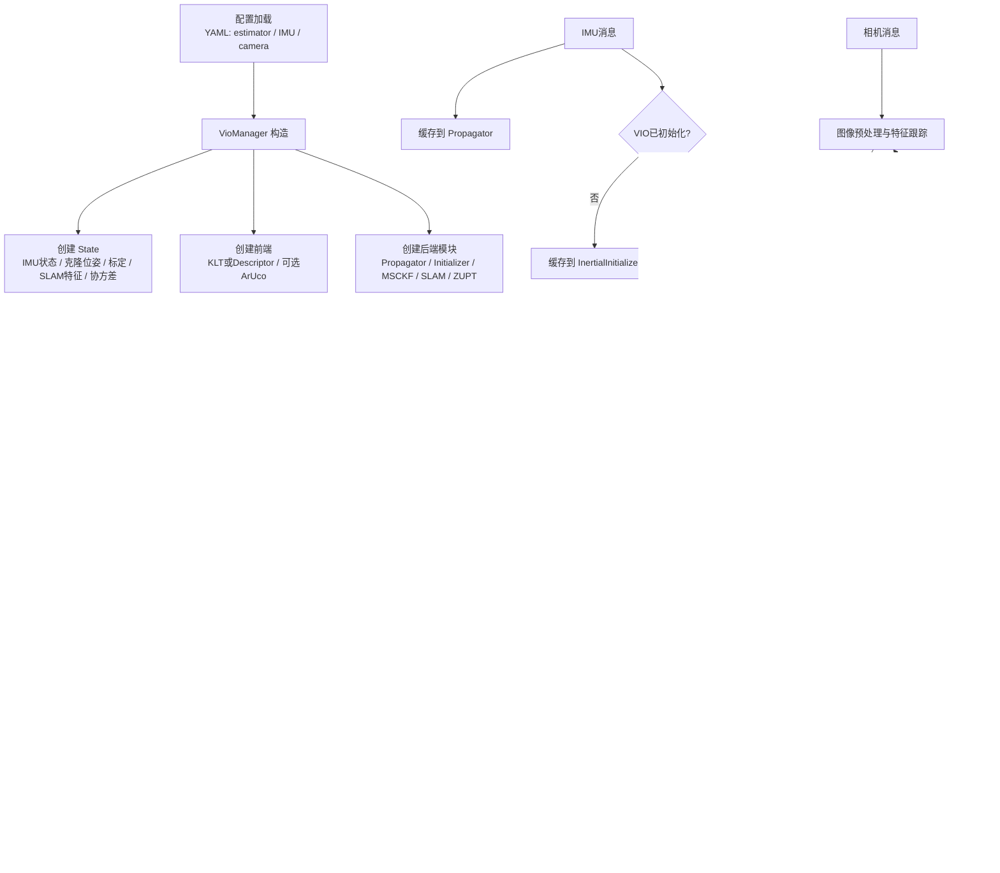
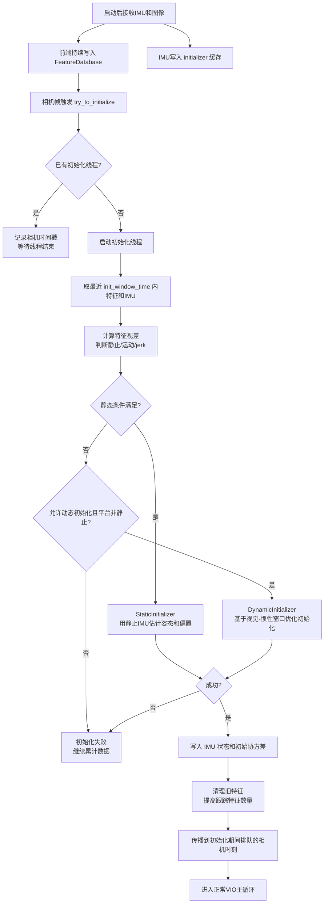
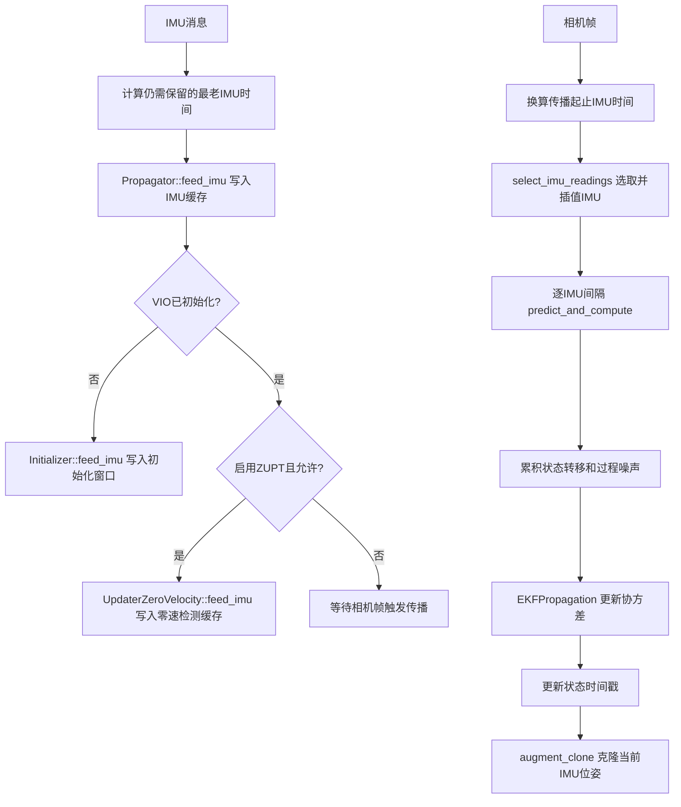
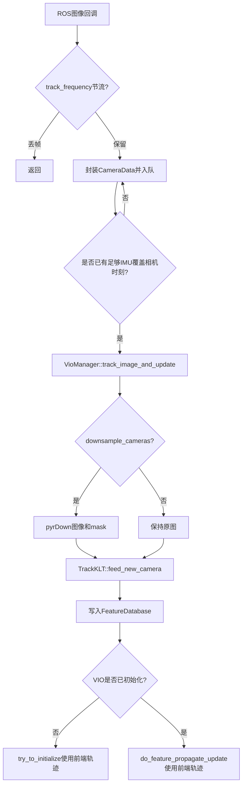
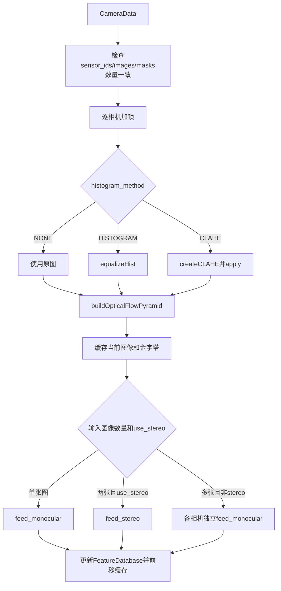
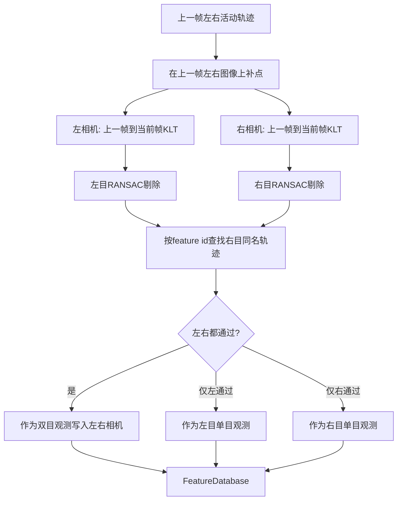
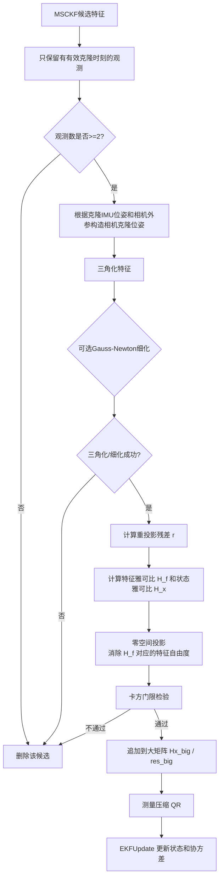
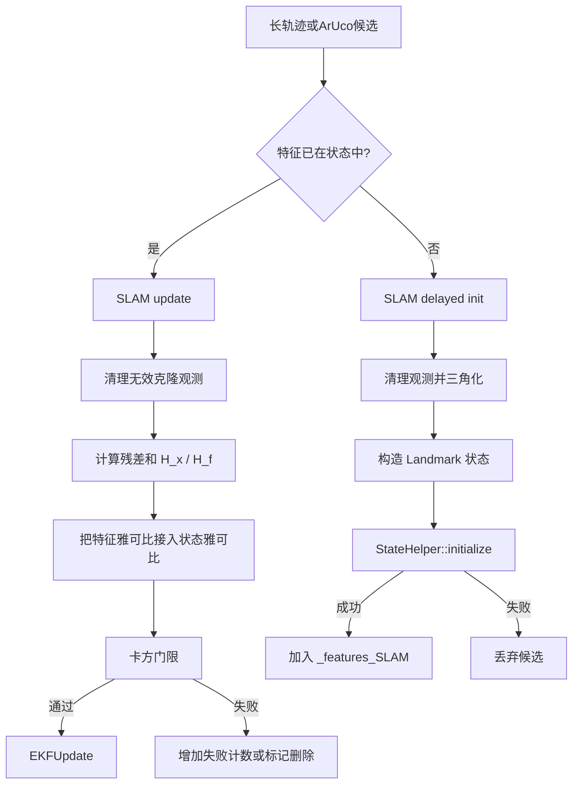
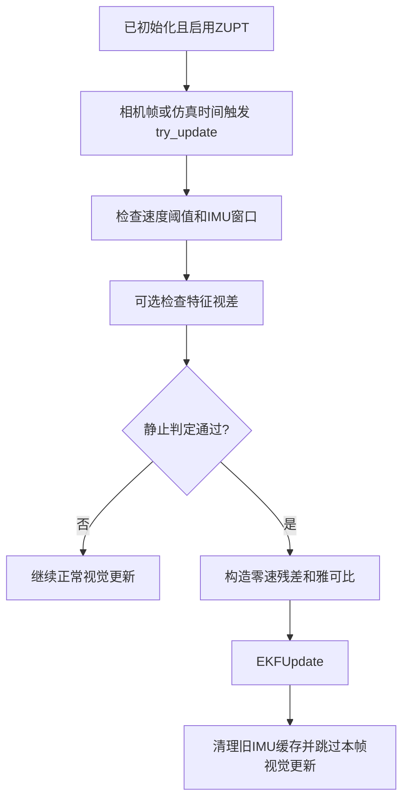

# OpenVINS 当前算法说明

本文档基于当前仓库代码整理 OpenVINS 的实际运行流程，重点对应 `ov_msckf` 主估计器、`ov_core` 特征前端和 `ov_init` 初始化模块。当前 EuRoC 配置文件为 `config/euroc_mav/estimator_config.yaml`，默认路径是双目 KLT 前端、IMU RK4 传播、EKF/MSCKF 滑窗更新，并在线估计相机外参、相机内参和相机-IMU 时间偏移。

## 1. 算法总览

OpenVINS 是滤波式视觉惯性里程计。系统以 IMU 为高频预测源，以相机图像触发低频更新；核心滤波器是误差状态 EKF，视觉更新采用 MSCKF 滑窗约束，并可选维护一部分长期 SLAM 特征和 ArUco 特征。



主要代码入口：

- ROS 入口：`ov_msckf/src/run_subscribe_msckf.cpp`
- ROS 回调与发布：`ov_msckf/src/ros/ROS1Visualizer.cpp`、`ov_msckf/src/ros/ROS2Visualizer.cpp`
- 主估计器：`ov_msckf/src/core/VioManager.cpp`
- IMU 传播：`ov_msckf/src/state/Propagator.cpp`
- EKF 状态与协方差管理：`ov_msckf/src/state/State.h`、`ov_msckf/src/state/StateHelper.cpp`
- MSCKF 更新：`ov_msckf/src/update/UpdaterMSCKF.cpp`
- SLAM/ArUco 更新：`ov_msckf/src/update/UpdaterSLAM.cpp`
- 初始化：`ov_init/src/init/InertialInitializer.cpp`
- KLT 前端：`ov_core/src/track/TrackKLT.cpp`

## 2. 输入与配置

当前 ROS 订阅链路将传感器消息转换成 OpenVINS 内部结构：

- IMU：`sensor_msgs/Imu` 转为 `ov_core::ImuData`，字段包括时间戳、角速度 $\boldsymbol{\omega}_m$（代码字段 `wm`）和线加速度 $\mathbf{a}_m$（代码字段 `am`）。
- 单目或多目图像：`sensor_msgs/Image` 转为 `ov_core::CameraData`，包含时间戳、相机 ID、灰度图和 mask。
- 双目配置下使用 `message_filters::Synchronizer` 同步左右图像，当前 EuRoC 配置订阅 `/cam0/image_raw`、`/cam1/image_raw`、`/imu0`。

当前 `config/euroc_mav/estimator_config.yaml` 的关键算法配置：

| 配置项 | 当前值 | 作用 |
| --- | --- | --- |
| `use_fej` | `true` | 使用 First-Estimate Jacobian，提高滤波一致性 |
| `integration` | `rk4` | IMU 均值使用 RK4 传播，协方差使用解析雅可比传播 |
| `use_stereo` | `true` | 双目特征跟踪 |
| `max_cameras` | `2` | 两个相机 |
| `calib_cam_extrinsics` | `true` | 在线估计 IMU 到相机外参 |
| `calib_cam_intrinsics` | `true` | 在线估计相机内参 |
| `calib_cam_timeoffset` | `true` | 在线估计相机到 IMU 时间偏移 |
| `calib_imu_intrinsics` | `false` | 当前不估计 IMU 内参 |
| `max_clones` | `11` | 滑窗中最多保留 11 个 IMU 克隆位姿 |
| `max_slam` | `50` | 状态中最多维护 50 个 SLAM 特征 |
| `max_msckf_in_update` | `40` | 每次最多使用 40 个 MSCKF 特征 |
| `use_klt` | `true` | 使用 KLT 光流前端 |
| `try_zupt` | `false` | 当前不启用零速更新 |
| `use_aruco` | `false` | 当前不启用 ArUco 跟踪 |

## 3. 状态向量

`State` 管理滤波器当前估计和协方差。用数学符号表示，核心状态可以概括为：

$$
\mathbf{x}=\begin{bmatrix}
\mathbf{x}_I &
\mathbf{x}_{c_1} & \cdots & \mathbf{x}_{c_N} &
\mathbf{f}_1 & \cdots & \mathbf{f}_M &
\Delta t_{CI} &
\mathbf{T}_{I}^{C_i} &
\boldsymbol{\zeta}_{C_i} &
\boldsymbol{\theta}_I
\end{bmatrix}^\top
$$

其中代码中的 `x_imu` 对应当前 IMU 状态 $\mathbf{x}_I$，`clone_imu(t_i)` 对应第 $i$ 个克隆位姿 $\mathbf{x}_{c_i}$，`x_slam_j` 对应第 $j$ 个 SLAM 特征 $\mathbf{f}_j$，`dt_cam_imu` 对应相机-IMU 时间偏移 $\Delta t_{CI}$，`T_imu_cam_i` 对应第 $i$ 个相机外参 $\mathbf{T}_{I}^{C_i}$，`cam_intrinsics_i` 对应相机内参 $\boldsymbol{\zeta}_{C_i}$，可选 `imu_intrinsics` 对应 IMU 内参 $\boldsymbol{\theta}_I$。

当前 IMU 状态可以进一步写成：

$$
\mathbf{x}_I=\begin{bmatrix}
\mathbf{q}_{G}^{I} &
\mathbf{p}_{I}^{G} &
\mathbf{v}_{I}^{G} &
\mathbf{b}_g &
\mathbf{b}_a
\end{bmatrix}^\top
$$

其中：

- 当前 IMU 状态 $\mathbf{x}_I$：姿态 $\mathbf{q}_{G}^{I}$、位置 $\mathbf{p}_{I}^{G}$、速度 $\mathbf{v}_{I}^{G}$、陀螺偏置 $\mathbf{b}_g$、加计偏置 $\mathbf{b}_a$。
- 克隆位姿 `_clones_IMU`：每个相机更新时刻克隆当前 IMU 位姿，数学上记为 $\mathbf{x}_{c_i}=\left[\mathbf{q}_{G}^{I_i},\mathbf{p}_{I_i}^{G}\right]$，只包含姿态和位置，用于构造 MSCKF 多状态约束。
- SLAM 特征 `_features_SLAM`：长期保留在状态向量中的特征点，数学上记为 $\mathbf{f}_j$，当前配置使用 `ANCHORED_MSCKF_INVERSE_DEPTH`。
- 标定状态：相机-IMU 时间偏移 $\Delta t_{CI}$、各相机外参 $\mathbf{T}_{I}^{C_i}$、各相机内参 $\boldsymbol{\zeta}_{C_i}$；当前 EuRoC 配置会在线估计这些量。
- 协方差 `_Cov`：数学上记为 $\mathbf{P}$，由 `StateHelper` 统一维护，传播、更新、克隆、边缘化都会同步调整变量顺序和协方差块。

## 4. 初始化流程

系统启动后并不会立即进入 MSCKF 更新，而是先积累一段 IMU 和特征轨迹，由 `InertialInitializer` 判断采用静态或动态初始化。



当前 EuRoC 配置 `init_dyn_use: false`，因此默认主要走静态初始化路径：

1. 收集 `init_window_time = 2.0s` 的 IMU 和特征观测。
2. 用图像特征视差判断平台是否静止或是否出现 jerk。
3. 静态初始化中，把最近窗口的加速度均值方向作为重力方向，估计初始姿态 $\mathbf{q}_{G}^{I}$；陀螺均值作为陀螺偏置 $\mathbf{b}_g$ 的初值；速度 $\mathbf{v}_{I}^{G}$ 和位置 $\mathbf{p}_{I}^{G}$ 按静止假设初始化。
4. 初始化成功后，`StateHelper::set_initial_covariance()` 将初始化模块返回的协方差写入滤波状态。

如果启用动态初始化，`DynamicInitializer` 会在初始化窗口内选择多个相机时刻和特征，结合 IMU 预积分/传播约束和视觉重投影约束估计初始姿态 $\mathbf{q}_{G}^{I}$、速度 $\mathbf{v}_{I}^{G}$、偏置 $\mathbf{b}_g,\mathbf{b}_a$ 和可选标定量。当前配置没有启用该路径。

## 5. IMU 处理与传播

IMU 处理分成两层：IMU 消息到来时只缓存原始测量；相机帧到来时，后端才把状态从上一帧相机时刻传播到当前相机时刻，并在传播后的时刻克隆一个 IMU 位姿。代码主路径是 `VioManager::feed_measurement_imu()`、`Propagator::feed_imu()`、`Propagator::propagate_and_clone()`、`Propagator::predict_and_compute()` 和 `StateHelper::EKFPropagation()`。



### 5.1 IMU 缓存阶段

IMU 消息进入 `VioManager::feed_measurement_imu()` 时，系统不会马上执行 EKF 传播。它只做三件事：

1. 将测量写入 `Propagator` 的 `imu_data` 缓存。
2. 若系统还未初始化，将同一条测量写入 `InertialInitializer` 的初始化缓存。
3. 若已经初始化且启用 ZUPT，将测量写入 `UpdaterZeroVelocity` 的零速检测缓存。

一条 IMU 测量可以写成：

$$
\mathbf{u}_{I,k}=\left(t_k,\boldsymbol{\omega}_{m,k},\mathbf{a}_{m,k}\right)
$$

其中 $t_k$ 是 IMU 时间戳，$\boldsymbol{\omega}_{m,k}$ 是陀螺仪测得的角速度，$\mathbf{a}_{m,k}$ 是加速度计测得的比力。代码字段分别是 `timestamp`、`wm` 和 `am`。

`Propagator::feed_imu()` 还会清理过旧 IMU。保留时间由当前滑窗中最老克隆位姿决定，并额外留出约 $0.10s$ 的余量，避免后续边界插值缺少数据。

### 5.2 相机时刻触发传播

视觉后端是相机帧驱动的。每次新相机帧进入 `VioManager::do_feature_propagate_update()` 后，会调用：

```text
Propagator::propagate_and_clone(state, t_cam)
```

这里 `t_cam` 是当前相机时间戳。传播前会先做两个时间合法性检查：

- 如果当前状态时间已经等于 `t_cam`，说明会在同一时刻重复插入克隆，代码直接报错退出。
- 如果当前状态时间晚于 `t_cam`，说明相机数据乱序或时间回退，代码直接报错退出。

传播目标不是简单的相机时间，而是相机时间对应的 IMU 时间。OpenVINS 在线估计相机到 IMU 的时间偏移，数学上记为 $\Delta t_{CI}$。传播区间为：

$$
t_0^I=t_{state}+\Delta t_{CI}^{old}
$$

$$
t_1^I=t_C+\Delta t_{CI}^{new}
$$

其中 $t_{state}$ 是当前滤波器状态时间，$t_C$ 是当前相机时间，$\Delta t_{CI}^{old}$ 是上一次传播时使用的时间偏移，$\Delta t_{CI}^{new}$ 是当前状态中最新估计的时间偏移。代码中对应：

```text
time0 = state->_timestamp + last_prop_time_offset
time1 = timestamp + t_off_new
```

这样处理的原因是：当前状态本身是在旧时间偏移下传播得到的，而当前相机帧应使用最新时间偏移对齐到 IMU 时钟。

### 5.3 IMU 读数选择与插值

`select_imu_readings(imu_data, time0, time1)` 会从缓存里取出覆盖 $[t_0^I,t_1^I]$ 的 IMU 序列。它不仅取中间的原始 IMU，还会在传播起点和终点做线性插值，使积分区间精确对齐相机更新时刻。

若两条相邻 IMU 为：

$$
\mathbf{u}_{I,i}=\left(t_i,\boldsymbol{\omega}_{m,i},\mathbf{a}_{m,i}\right),\quad
\mathbf{u}_{I,i+1}=\left(t_{i+1},\boldsymbol{\omega}_{m,i+1},\mathbf{a}_{m,i+1}\right)
$$

需要在 $t$ 处插值，则可概括为：

$$
\alpha=\frac{t-t_i}{t_{i+1}-t_i}
$$

$$
\boldsymbol{\omega}_m(t)=(1-\alpha)\boldsymbol{\omega}_{m,i}+\alpha\boldsymbol{\omega}_{m,i+1}
$$

$$
\mathbf{a}_m(t)=(1-\alpha)\mathbf{a}_{m,i}+\alpha\mathbf{a}_{m,i+1}
$$

如果缓存数据不足，代码会尝试把最后两条 IMU 外推/插值到目标终点，并移除 $\Delta t$ 近似为 0 的重复测量，避免过程噪声出现数值问题。最终至少需要两条 IMU 数据，才能形成一个积分间隔。

### 5.4 IMU 测量模型与去偏置

对每个 IMU 间隔 $[t_i,t_{i+1}]$，`predict_and_compute()` 会先根据当前状态中的 bias 和可选 IMU 内参修正原始测量。

原始测量模型可以写成：

$$
\boldsymbol{\omega}_{m}=\boldsymbol{\omega}+\mathbf{b}_g+\mathbf{n}_g
$$

$$
\mathbf{a}_{m}=\mathbf{a}+\mathbf{b}_a+\mathbf{n}_a
$$

其中：

- $\boldsymbol{\omega}$：真实角速度，表达在 IMU 坐标系中。
- $\mathbf{a}$：真实比力，表达在 IMU 坐标系中。
- $\mathbf{b}_g$：陀螺偏置，对应代码 `state->_imu->bias_g()`。
- $\mathbf{b}_a$：加计偏置，对应代码 `state->_imu->bias_a()`。
- $\mathbf{n}_g$：陀螺白噪声。
- $\mathbf{n}_a$：加计白噪声。

当前 EuRoC 配置 `calib_imu_intrinsics: false`，因此 IMU 内参修正通常退化为单位映射。完整代码仍保留了内参模型，修正形式为：

$$
\hat{\mathbf{a}}=\mathbf{R}_{A}^{I}\mathbf{D}_a\left(\mathbf{a}_m-\mathbf{b}_a\right)
$$

$$
\hat{\boldsymbol{\omega}}=\mathbf{R}_{W}^{I}\mathbf{D}_w\left(\boldsymbol{\omega}_m-\mathbf{b}_g-\mathbf{T}_g\hat{\mathbf{a}}\right)
$$

其中：

- $\hat{\mathbf{a}}$：去偏置并应用 IMU 内参后的加速度计比力。
- $\hat{\boldsymbol{\omega}}$：去偏置并应用 IMU 内参后的陀螺角速度。
- $\mathbf{D}_a,\mathbf{D}_w$：加速度计和陀螺仪的 scale/misalignment 矩阵，对应 `_calib_imu_da` 和 `_calib_imu_dw`。
- $\mathbf{R}_{A}^{I},\mathbf{R}_{W}^{I}$：加速度计坐标系、陀螺仪坐标系到 IMU 坐标系的旋转，对应 `_calib_imu_ACCtoIMU` 和 `_calib_imu_GYROtoIMU`。
- $\mathbf{T}_g$：陀螺 g-sensitivity 项，对应 `_calib_imu_tg`。

若不估计 IMU 内参，可近似看成：

$$
\hat{\mathbf{a}}\approx\mathbf{a}_m-\mathbf{b}_a,\quad
\hat{\boldsymbol{\omega}}\approx\boldsymbol{\omega}_m-\mathbf{b}_g
$$

### 5.5 连续时间运动模型

OpenVINS 的传播状态主要是当前 IMU 状态：

$$
\mathbf{x}_I=\begin{bmatrix}
\mathbf{q}_{G}^{I} & \mathbf{p}_{I}^{G} & \mathbf{v}_{I}^{G} & \mathbf{b}_g & \mathbf{b}_a
\end{bmatrix}^\top
$$

其中 $\mathbf{q}_{G}^{I}$ 表示从全局系 $G$ 到 IMU 系 $I$ 的姿态，$\mathbf{p}_{I}^{G}$ 是 IMU 在全局系的位置，$\mathbf{v}_{I}^{G}$ 是 IMU 在全局系的速度。

按当前代码的坐标约定，连续时间名义状态传播可概括为：

$$
\dot{\mathbf{q}}_{G}^{I}=\frac{1}{2}\Omega\left(\hat{\boldsymbol{\omega}}\right)\mathbf{q}_{G}^{I}
$$

$$
\dot{\mathbf{p}}_{I}^{G}=\mathbf{v}_{I}^{G}
$$

$$
\dot{\mathbf{v}}_{I}^{G}=\left(\mathbf{R}_{G}^{I}\right)^\top\hat{\mathbf{a}}-\mathbf{g}^{G}
$$

$$
\dot{\mathbf{b}}_g=\mathbf{n}_{wg},\quad
\dot{\mathbf{b}}_a=\mathbf{n}_{wa}
$$

其中：

- $\Omega(\cdot)$：四元数运动学矩阵，代码中为 `Omega(w_hat)`。
- $\mathbf{R}_{G}^{I}$：由 $\mathbf{q}_{G}^{I}$ 得到的旋转矩阵，代码中为 `state->_imu->Rot()`。
- $\left(\mathbf{R}_{G}^{I}\right)^\top\hat{\mathbf{a}}$：把 IMU 坐标系中的比力转到全局坐标系。
- $\mathbf{g}^{G}=\begin{bmatrix}0&0&g\end{bmatrix}^\top$：全局重力向量，当前配置 $g=9.81$。
- $\mathbf{n}_{wg},\mathbf{n}_{wa}$：陀螺偏置和加计偏置的随机游走噪声。

注意：名义状态传播时 $\mathbf{b}_g$ 和 $\mathbf{b}_a$ 在一个小积分间隔内保持当前估计值不变；它们的不确定性通过随机游走噪声进入协方差传播。

### 5.6 RK4 名义状态积分

当前 EuRoC 配置 `integration: "rk4"`。因此 `predict_mean_rk4()` 用四阶 Runge-Kutta（RK4）积分名义状态中的姿态、位置和速度。RK4 的目的不是改变运动模型，而是在一个 IMU 采样间隔内用 4 次导数采样近似连续时间积分，比简单欧拉积分更稳定。

对单个 IMU 间隔：

$$
\Delta t=t_{i+1}-t_i
$$

代码先用区间两端修正后的 IMU 测量估计区间内角速度和比力的线性变化：

$$
\boldsymbol{\alpha}_{\omega}=\frac{\hat{\boldsymbol{\omega}}_{i+1}-\hat{\boldsymbol{\omega}}_{i}}{\Delta t}
$$

$$
\mathbf{j}_a=\frac{\hat{\mathbf{a}}_{i+1}-\hat{\mathbf{a}}_{i}}{\Delta t}
$$

其中 $\boldsymbol{\alpha}_{\omega}$ 对应代码 `w_alpha`，表示角速度在该 IMU 间隔内的线性变化率；$\mathbf{j}_a$ 对应代码 `a_jerk`，表示比力在该 IMU 间隔内的线性变化率。对区间内任意相对时间 $\tau\in[0,\Delta t]$，代码等价于使用：

$$
\hat{\boldsymbol{\omega}}(\tau)=\hat{\boldsymbol{\omega}}_{i}+\tau\boldsymbol{\alpha}_{\omega}
$$

$$
\hat{\mathbf{a}}(\tau)=\hat{\mathbf{a}}_{i}+\tau\mathbf{j}_a
$$

#### 5.6.1 这里的 $f$ 函数是什么

通用 RK4 公式中的 $f(\mathbf{y},t)$ 表示连续时间微分方程右侧，也就是“给定当前状态和当前时刻输入，返回状态导数”的函数：

$$
\dot{\mathbf{y}}=f(\mathbf{y},t)
$$

在本节中，$\mathbf{y}$ 不是完整 EKF 状态，而是 RK4 名义积分临时使用的组合变量：

$$
\mathbf{y}=\left(\delta\mathbf{q},\mathbf{p}_{I}^{G},\mathbf{v}_{I}^{G}\right)
$$

其中：

- $\delta\mathbf{q}$：从当前积分起点姿态出发的局部四元数增量，代码中是 `dq_0`、`dq_1`、`dq_2`、`dq_3`。
- $\mathbf{p}_{I}^{G}$：IMU 在全局坐标系中的位置。
- $\mathbf{v}_{I}^{G}$：IMU 在全局坐标系中的速度。

因此 OpenVINS 这里的 $f$ 可以展开为三个导数：

$$
f\left(\delta\mathbf{q},\mathbf{p}_{I}^{G},\mathbf{v}_{I}^{G},\tau\right)=
\begin{bmatrix}
\dot{\delta\mathbf{q}} \\
\dot{\mathbf{p}}_{I}^{G} \\
\dot{\mathbf{v}}_{I}^{G}
\end{bmatrix}
$$

其中：

$$
\dot{\delta\mathbf{q}}=\frac{1}{2}\Omega\left(\hat{\boldsymbol{\omega}}(\tau)\right)\delta\mathbf{q}
$$

$$
\dot{\mathbf{p}}_{I}^{G}=\mathbf{v}_{I}^{G}
$$

$$
\dot{\mathbf{v}}_{I}^{G}=\left(\mathbf{R}_{G}^{I}(\delta\mathbf{q})\right)^\top\hat{\mathbf{a}}(\tau)-\mathbf{g}^{G}
$$

这里 $\mathbf{R}_{G}^{I}(\delta\mathbf{q})$ 是当前 RK4 子阶段的姿态旋转矩阵。代码先把局部增量 $\delta\mathbf{q}$ 与积分起点姿态 $\mathbf{q}_{G,i}^{I}$ 复合，再转成旋转矩阵：

$$
\mathbf{R}_{G}^{I}(\delta\mathbf{q})=R\left(\delta\mathbf{q}\otimes\mathbf{q}_{G,i}^{I}\right)
$$

这正对应代码中的：

```text
R_Gto0 = quat_2_Rot(quat_multiply(dq_0, q_0))
R_Gto1 = quat_2_Rot(quat_multiply(dq_1, q_0))
R_Gto2 = quat_2_Rot(quat_multiply(dq_2, q_0))
R_Gto3 = quat_2_Rot(quat_multiply(dq_3, q_0))
```

所以，$f$ 的直观含义是：当前角速度决定姿态增量怎么变，当前速度决定位置怎么变，当前姿态和比力决定速度怎么变。

#### 5.6.2 四个 RK4 斜率的代码含义

RK4 会在区间起点、中点、中点和终点分别计算导数。代码不是用一个统一的 `f()` 函数对象实现，而是把 $f$ 的三个输出拆成了姿态、位置、速度三组斜率：`k*_q`、`k*_p`、`k*_v`。

第 1 阶段在 $\tau=0$，使用区间起点 IMU：

$$
\delta\mathbf{q}_0=\begin{bmatrix}0&0&0&1\end{bmatrix}^\top,\quad
\mathbf{v}_0=\mathbf{v}_{I,i}^{G}
$$

$$
\mathbf{k}_{1q}=\Delta t\cdot\frac{1}{2}\Omega\left(\hat{\boldsymbol{\omega}}_i\right)\delta\mathbf{q}_0
$$

$$
\mathbf{k}_{1p}=\Delta t\cdot\mathbf{v}_0
$$

$$
\mathbf{k}_{1v}=\Delta t\cdot\left(\left(\mathbf{R}_{G}^{I}(\delta\mathbf{q}_0)\right)^\top\hat{\mathbf{a}}_i-\mathbf{g}^{G}\right)
$$

第 2 阶段在 $\tau=\frac{1}{2}\Delta t$，使用区间中点 IMU 和第 1 阶段得到的中点预测：

$$
\hat{\boldsymbol{\omega}}_{mid}=\hat{\boldsymbol{\omega}}_i+\frac{1}{2}\Delta t\boldsymbol{\alpha}_{\omega}
$$

$$
\hat{\mathbf{a}}_{mid}=\hat{\mathbf{a}}_i+\frac{1}{2}\Delta t\mathbf{j}_a
$$

$$
\delta\mathbf{q}_1=\operatorname{norm}\left(\delta\mathbf{q}_0+\frac{1}{2}\mathbf{k}_{1q}\right),\quad
\mathbf{v}_1=\mathbf{v}_0+\frac{1}{2}\mathbf{k}_{1v}
$$

$$
\mathbf{k}_{2q}=\Delta t\cdot\frac{1}{2}\Omega\left(\hat{\boldsymbol{\omega}}_{mid}\right)\delta\mathbf{q}_1
$$

$$
\mathbf{k}_{2p}=\Delta t\cdot\mathbf{v}_1
$$

$$
\mathbf{k}_{2v}=\Delta t\cdot\left(\left(\mathbf{R}_{G}^{I}(\delta\mathbf{q}_1)\right)^\top\hat{\mathbf{a}}_{mid}-\mathbf{g}^{G}\right)
$$

第 3 阶段仍在 $\tau=\frac{1}{2}\Delta t$，但使用第 2 阶段给出的另一组中点预测：

$$
\delta\mathbf{q}_2=\operatorname{norm}\left(\delta\mathbf{q}_0+\frac{1}{2}\mathbf{k}_{2q}\right),\quad
\mathbf{v}_2=\mathbf{v}_0+\frac{1}{2}\mathbf{k}_{2v}
$$

$$
\mathbf{k}_{3q}=\Delta t\cdot\frac{1}{2}\Omega\left(\hat{\boldsymbol{\omega}}_{mid}\right)\delta\mathbf{q}_2
$$

$$
\mathbf{k}_{3p}=\Delta t\cdot\mathbf{v}_2
$$

$$
\mathbf{k}_{3v}=\Delta t\cdot\left(\left(\mathbf{R}_{G}^{I}(\delta\mathbf{q}_2)\right)^\top\hat{\mathbf{a}}_{mid}-\mathbf{g}^{G}\right)
$$

第 4 阶段在 $\tau=\Delta t$，使用区间终点 IMU 和第 3 阶段给出的终点预测：

$$
\delta\mathbf{q}_3=\operatorname{norm}\left(\delta\mathbf{q}_0+\mathbf{k}_{3q}\right),\quad
\mathbf{v}_3=\mathbf{v}_0+\mathbf{k}_{3v}
$$

$$
\mathbf{k}_{4q}=\Delta t\cdot\frac{1}{2}\Omega\left(\hat{\boldsymbol{\omega}}_{i+1}\right)\delta\mathbf{q}_3
$$

$$
\mathbf{k}_{4p}=\Delta t\cdot\mathbf{v}_3
$$

$$
\mathbf{k}_{4v}=\Delta t\cdot\left(\left(\mathbf{R}_{G}^{I}(\delta\mathbf{q}_3)\right)^\top\hat{\mathbf{a}}_{i+1}-\mathbf{g}^{G}\right)
$$

这里有两个实现细节值得注意：

- 代码对每个中间四元数增量调用 `quatnorm()`，保证 $\delta\mathbf{q}$ 仍是单位四元数。
- 代码没有显式维护中间位置 $\mathbf{p}_1,\mathbf{p}_2,\mathbf{p}_3$，因为位置导数只依赖速度 $\dot{\mathbf{p}}=\mathbf{v}$，不直接影响姿态导数或速度导数。

#### 5.6.3 RK4 合成结果

四个阶段完成后，姿态增量、位置和速度按 RK4 权重合成：

$$
\delta\mathbf{q}=\operatorname{norm}\left(\delta\mathbf{q}_0+\frac{1}{6}\mathbf{k}_{1q}+\frac{1}{3}\mathbf{k}_{2q}+\frac{1}{3}\mathbf{k}_{3q}+\frac{1}{6}\mathbf{k}_{4q}\right)
$$

$$
\mathbf{p}_{I,i+1}^{G}=\mathbf{p}_{I,i}^{G}+\frac{1}{6}\mathbf{k}_{1p}+\frac{1}{3}\mathbf{k}_{2p}+\frac{1}{3}\mathbf{k}_{3p}+\frac{1}{6}\mathbf{k}_{4p}
$$

$$
\mathbf{v}_{I,i+1}^{G}=\mathbf{v}_{I,i}^{G}+\frac{1}{6}\mathbf{k}_{1v}+\frac{1}{3}\mathbf{k}_{2v}+\frac{1}{3}\mathbf{k}_{3v}+\frac{1}{6}\mathbf{k}_{4v}
$$

最终姿态不是直接把 $\delta\mathbf{q}$ 当作全局姿态，而是把它复合到积分起点姿态上：

$$
\mathbf{q}_{G,i+1}^{I}=\delta\mathbf{q}\otimes\mathbf{q}_{G,i}^{I}
$$

对应代码：

```text
new_q = quat_multiply(dq, q_0)
new_p = p_0 + 1/6*k1_p + 1/3*k2_p + 1/3*k3_p + 1/6*k4_p
new_v = v_0 + 1/6*k1_v + 1/3*k2_v + 1/3*k3_v + 1/6*k4_v
```

总结来说，本节里的 $f$ 不是一个神秘的新模型，而是第 5.5 节连续时间运动模型在某个 RK4 子阶段的导数计算。它把当前临时姿态、速度和当前插值得到的 IMU 输入映射成 $\dot{\delta\mathbf{q}}$、$\dot{\mathbf{p}}$、$\dot{\mathbf{v}}$，再由 RK4 加权积分出 `new_q`、`new_p` 和 `new_v`。

### 5.7 误差状态、状态转移和过程噪声

第 5.6 节的 RK4 更新的是名义状态，也就是 `new_q`、`new_p`、`new_v` 这些当前最优估计。EKF 还必须同步传播“不确定性”，也就是误差状态和协方差。OpenVINS 在 `predict_and_compute()` 中先传播名义状态，再调用 `compute_F_and_G_analytic()` 或 `compute_F_and_G_discrete()` 构造状态转移矩阵和噪声注入矩阵。

当前 EuRoC 配置为 `integration: "rk4"`。代码逻辑是：名义状态均值使用 RK4 积分；协方差传播使用解析雅可比路径，即 `compute_F_and_G_analytic()`。因此下面以解析雅可比为主解释，同时说明它与离散形式的关系。

#### 5.7.1 误差状态是什么

滤波器保存的名义 IMU 状态为：

$$
\mathbf{x}_I=\begin{bmatrix}
\mathbf{q}_{G}^{I} & \mathbf{p}_{I}^{G} & \mathbf{v}_{I}^{G} & \mathbf{b}_g & \mathbf{b}_a
\end{bmatrix}^\top
$$

EKF 传播的不是直接状态差，而是小量误差状态：

$$
\delta\mathbf{x}_I=\begin{bmatrix}
\delta\boldsymbol{\theta} & \delta\mathbf{p} & \delta\mathbf{v} & \delta\mathbf{b}_g & \delta\mathbf{b}_a
\end{bmatrix}^\top
$$

各块含义如下：

- $\delta\boldsymbol{\theta}$：3 维姿态小角度误差。姿态本身是四元数 $\mathbf{q}_{G}^{I}$，但误差只用 3 维小旋转表示。
- $\delta\mathbf{p}$：3 维位置误差，对应 $\mathbf{p}_{I}^{G}$ 的不确定性。
- $\delta\mathbf{v}$：3 维速度误差，对应 $\mathbf{v}_{I}^{G}$ 的不确定性。
- $\delta\mathbf{b}_g$：3 维陀螺偏置误差。
- $\delta\mathbf{b}_a$：3 维加计偏置误差。

代码中的局部排列顺序正是：

```text
th_id -> delta theta
p_id  -> delta p
v_id  -> delta v
bg_id -> delta b_g
ba_id -> delta b_a
```

因此基础 IMU 误差状态是 15 维。如果启用 IMU 内参标定，还会在后面追加 $\delta\mathbf{D}_w$、$\delta\mathbf{D}_a$、$\delta\mathbf{T}_g$、$\delta\boldsymbol{\theta}_{A}^{I}$ 或 $\delta\boldsymbol{\theta}_{W}^{I}$ 等内参误差。当前 EuRoC 配置 `calib_imu_intrinsics: false`，所以实际传播主要是这 15 维。

#### 5.7.2 单个 IMU 间隔的误差传播

对一个 IMU 积分间隔 $[t_i,t_{i+1}]$，误差状态的一阶离散传播写成：

$$
\delta\mathbf{x}_{i+1}=\boldsymbol{\Phi}_i\delta\mathbf{x}_{i}+\mathbf{G}_i\mathbf{n}_i
$$

其中：

- $\boldsymbol{\Phi}_i$：单个 IMU 间隔的离散状态转移矩阵，代码里变量名是 `F`。
- $\mathbf{G}_i$：噪声注入矩阵，代码里变量名是 `G`。
- $\mathbf{n}_i$：IMU 噪声向量，包括陀螺白噪声、加计白噪声、陀螺 bias 随机游走、加计 bias 随机游走。

噪声向量按代码列顺序为：

$$
\mathbf{n}_i=\begin{bmatrix}
\mathbf{n}_g & \mathbf{n}_a & \mathbf{n}_{wg} & \mathbf{n}_{wa}
\end{bmatrix}^\top
$$

对应 `G` 的列块：

| 噪声块 | 维度 | `G` 的列范围 | 含义 |
| --- | --- | --- | --- |
| $\mathbf{n}_g$ | 3 | `0:3` | 陀螺角速度白噪声，主要影响姿态，也会通过姿态影响速度和位置。 |
| $\mathbf{n}_a$ | 3 | `3:6` | 加速度计白噪声，主要影响速度和位置，也可能通过 g-sensitivity 影响姿态。 |
| $\mathbf{n}_{wg}$ | 3 | `6:9` | 陀螺偏置随机游走，影响 $\mathbf{b}_g$ 的协方差。 |
| $\mathbf{n}_{wa}$ | 3 | `9:12` | 加计偏置随机游走，影响 $\mathbf{b}_a$ 的协方差。 |

#### 5.7.3 状态转移矩阵 $\boldsymbol{\Phi}_i$ 的主要块

将基础 15 维误差状态按 $\delta\boldsymbol{\theta},\delta\mathbf{p},\delta\mathbf{v},\delta\mathbf{b}_g,\delta\mathbf{b}_a$ 分块，状态转移矩阵可概括为：

$$
\boldsymbol{\Phi}_i=
\begin{bmatrix}
\boldsymbol{\Phi}_{\theta\theta} & \mathbf{0} & \mathbf{0} & \boldsymbol{\Phi}_{\theta b_g} & \boldsymbol{\Phi}_{\theta b_a} \\
\boldsymbol{\Phi}_{p\theta} & \mathbf{I} & \Delta t\mathbf{I} & \boldsymbol{\Phi}_{p b_g} & \boldsymbol{\Phi}_{p b_a} \\
\boldsymbol{\Phi}_{v\theta} & \mathbf{0} & \mathbf{I} & \boldsymbol{\Phi}_{v b_g} & \boldsymbol{\Phi}_{v b_a} \\
\mathbf{0} & \mathbf{0} & \mathbf{0} & \mathbf{I} & \mathbf{0} \\
\mathbf{0} & \mathbf{0} & \mathbf{0} & \mathbf{0} & \mathbf{I}
\end{bmatrix}
$$

这个矩阵每个非零块都有直观含义：

- $\boldsymbol{\Phi}_{\theta\theta}$：上一时刻姿态误差如何旋转到下一时刻姿态误差。
- $\boldsymbol{\Phi}_{p\theta}$：姿态误差会改变加速度投到全局系的方向，因此会影响位置。
- $\boldsymbol{\Phi}_{v\theta}$：姿态误差会改变加速度投到全局系的方向，因此会影响速度。
- $\Delta t\mathbf{I}$：速度误差会积分成位置误差。
- $\boldsymbol{\Phi}_{\theta b_g}$：陀螺偏置误差会直接影响姿态积分。
- $\boldsymbol{\Phi}_{p b_g},\boldsymbol{\Phi}_{v b_g}$：陀螺偏置误差先影响姿态，再间接影响位置和速度。
- $\boldsymbol{\Phi}_{p b_a},\boldsymbol{\Phi}_{v b_a}$：加计偏置误差会直接影响速度和位置积分。
- bias 对自己的块为 $\mathbf{I}$：名义 bias 在小区间内不变，bias 不确定性通过随机游走噪声增长。

在解析雅可比实现中，代码使用传播前的 FEJ 线性化点 $\mathbf{R}_k,\mathbf{p}_k,\mathbf{v}_k$，以及传播后的 $\mathbf{q}_{k+1},\mathbf{p}_{k+1},\mathbf{v}_{k+1}$ 构造主要块。例如：

$$
\boldsymbol{\Phi}_{\theta\theta}=\Delta\mathbf{R}_{k\rightarrow k+1}
$$

$$
\boldsymbol{\Phi}_{p\theta}=-\left[\mathbf{p}_{k+1}-\mathbf{p}_{k}-\mathbf{v}_{k}\Delta t+\frac{1}{2}\mathbf{g}^{G}\Delta t^2\right]_{\times}\mathbf{R}_{k}^{\top}
$$

$$
\boldsymbol{\Phi}_{v\theta}=-\left[\mathbf{v}_{k+1}-\mathbf{v}_{k}+\mathbf{g}^{G}\Delta t\right]_{\times}\mathbf{R}_{k}^{\top}
$$

其中：

- $\Delta\mathbf{R}_{k\rightarrow k+1}$ 对应代码中的 `dR_ktok1`。
- $[\cdot]_{\times}$ 是反对称矩阵，代码中为 `skew_x()`。
- 如果 `use_fej: true`，$\mathbf{R}_k,\mathbf{p}_k,\mathbf{v}_k$ 使用第一次估计值 `Rot_fej()`、`pos_fej()`、`vel_fej()`，以提高滤波一致性。

#### 5.7.4 bias 相关块的意义

陀螺偏置误差会让去偏置角速度出错：

$$
\hat{\boldsymbol{\omega}}=\boldsymbol{\omega}_m-\mathbf{b}_g
$$

因此 $\delta\mathbf{b}_g$ 会直接进入姿态误差传播。解析实现里主要形式为：

$$
\boldsymbol{\Phi}_{\theta b_g}
=-\Delta\mathbf{R}_{k\rightarrow k+1}\mathbf{J}_r\Delta t\mathbf{R}_{W}^{I}\mathbf{D}_w
$$

其中 $\mathbf{J}_r$ 是 SO(3) 右雅可比，对应代码 `Jr_ktok1`。由于姿态误差还会影响重力补偿后的加速度投影，代码还保留了 $\boldsymbol{\Phi}_{p b_g}$ 和 $\boldsymbol{\Phi}_{v b_g}$：

$$
\boldsymbol{\Phi}_{p b_g}=\mathbf{R}_{k}^{\top}\boldsymbol{\Xi}_4\mathbf{R}_{W}^{I}\mathbf{D}_w
$$

$$
\boldsymbol{\Phi}_{v b_g}=\mathbf{R}_{k}^{\top}\boldsymbol{\Xi}_3\mathbf{R}_{W}^{I}\mathbf{D}_w
$$

加计偏置误差会让比力出错：

$$
\hat{\mathbf{a}}=\mathbf{a}_m-\mathbf{b}_a
$$

因此它直接影响速度和位置。若忽略 IMU 内参和 g-sensitivity，可近似理解为：

$$
\boldsymbol{\Phi}_{v b_a}\approx-\left(\mathbf{R}_{G}^{I}\right)^\top\Delta t
$$

$$
\boldsymbol{\Phi}_{p b_a}\approx-\frac{1}{2}\left(\mathbf{R}_{G}^{I}\right)^\top\Delta t^2
$$

完整代码还考虑了 $\mathbf{R}_{A}^{I}$、$\mathbf{D}_a$、$\mathbf{T}_g$ 等 IMU 内参项，因此解析形式中会出现 $\boldsymbol{\Xi}_1,\boldsymbol{\Xi}_2,\boldsymbol{\Xi}_3,\boldsymbol{\Xi}_4$。这些 $\boldsymbol{\Xi}$ 矩阵来自 `compute_Xi_sum()`，用于表达一个 IMU 间隔内旋转和加速度耦合的解析积分项。

#### 5.7.5 噪声注入矩阵 $\mathbf{G}_i$

$\mathbf{G}_i$ 描述连续 IMU 噪声如何进入离散误差状态。基础结构可以概括为：

$$
\mathbf{G}_i=
\begin{bmatrix}
\mathbf{G}_{\theta n_g} & \mathbf{G}_{\theta n_a} & \mathbf{0} & \mathbf{0} \\
\mathbf{G}_{p n_g} & \mathbf{G}_{p n_a} & \mathbf{0} & \mathbf{0} \\
\mathbf{G}_{v n_g} & \mathbf{G}_{v n_a} & \mathbf{0} & \mathbf{0} \\
\mathbf{0} & \mathbf{0} & \Delta t\mathbf{I} & \mathbf{0} \\
\mathbf{0} & \mathbf{0} & \mathbf{0} & \Delta t\mathbf{I}
\end{bmatrix}
$$

其中：

- $\mathbf{G}_{\theta n_g}$：陀螺白噪声对姿态误差的影响。
- $\mathbf{G}_{p n_g},\mathbf{G}_{v n_g}$：陀螺白噪声通过姿态误差间接影响位置和速度。
- $\mathbf{G}_{p n_a},\mathbf{G}_{v n_a}$：加计白噪声直接影响位置和速度。
- $\Delta t\mathbf{I}$：bias 随机游走噪声在一个离散间隔内注入 bias 误差。

当前 EuRoC 默认不启用 IMU 内参和 g-sensitivity 时，可以近似看成：

$$
\mathbf{G}_{v n_a}\approx-\left(\mathbf{R}_{G}^{I}\right)^\top\Delta t
$$

$$
\mathbf{G}_{p n_a}\approx-\frac{1}{2}\left(\mathbf{R}_{G}^{I}\right)^\top\Delta t^2
$$

解析代码中，$\mathbf{G}_{\theta n_g}$、$\mathbf{G}_{p n_g}$、$\mathbf{G}_{v n_g}$ 也会通过 $\mathbf{J}_r$ 和 $\boldsymbol{\Xi}$ 项保留旋转耦合，和 $\boldsymbol{\Phi}$ 中 bias 块的形式相似。

#### 5.7.6 连续噪声协方差 $\mathbf{Q}_c$

OpenVINS 的噪声参数来自 `NoiseManager`，按四类噪声构造 12 维噪声协方差：

$$
\mathbf{Q}_c=\operatorname{diag}\left(
\frac{\sigma_g^2}{\Delta t}\mathbf{I}_3,
\frac{\sigma_a^2}{\Delta t}\mathbf{I}_3,
\frac{\sigma_{wg}^2}{\Delta t}\mathbf{I}_3,
\frac{\sigma_{wa}^2}{\Delta t}\mathbf{I}_3
\right)
$$

其中：

- $\sigma_g$：陀螺白噪声标准差，代码 `_noises.sigma_w`。
- $\sigma_a$：加计白噪声标准差，代码 `_noises.sigma_a`。
- $\sigma_{wg}$：陀螺偏置随机游走标准差，代码 `_noises.sigma_wb`。
- $\sigma_{wa}$：加计偏置随机游走标准差，代码 `_noises.sigma_ab`。

代码使用 $\sigma^2/\Delta t$ 是为了把配置中的连续时间噪声转换到当前离散 IMU 间隔。随后通过 $\mathbf{G}_i$ 注入状态，得到离散过程噪声：

$$
\mathbf{Q}_{d,i}=\mathbf{G}_i\mathbf{Q}_c\mathbf{G}_i^\top
$$

最后做一次对称化，减少数值误差：

$$
\mathbf{Q}_{d,i}\leftarrow\frac{1}{2}\left(\mathbf{Q}_{d,i}+\mathbf{Q}_{d,i}^\top\right)
$$

#### 5.7.7 与名义状态传播的关系

`predict_and_compute()` 在一个 IMU 间隔内同时完成两件事：

1. 用 `predict_mean_rk4()` 得到新的名义状态 $\mathbf{q}_{G,k+1}^{I}$、$\mathbf{p}_{I,k+1}^{G}$、$\mathbf{v}_{I,k+1}^{G}$。
2. 用当前线性化点和新名义状态构造 $\boldsymbol{\Phi}_i$ 与 $\mathbf{Q}_{d,i}$。

因此，名义状态和协方差不是两套独立流程。名义积分给出下一时刻的姿态、位置、速度；误差状态传播则说明“上一时刻的小误差和 IMU 噪声会如何变成下一时刻的小误差”。随后第 5.8 节会把多个 IMU 间隔的 $\boldsymbol{\Phi}_i$ 和 $\mathbf{Q}_{d,i}$ 累积成相机帧间的一次总传播。

### 5.8 多个 IMU 间隔的累积传播

相机帧之间通常包含多个 IMU 间隔。OpenVINS 没有每个间隔都直接更新完整协方差，而是先累积总状态转移和总噪声：

$$
\boldsymbol{\Phi}_{\Sigma}\leftarrow\boldsymbol{\Phi}_i\boldsymbol{\Phi}_{\Sigma}
$$

$$
\mathbf{Q}_{\Sigma}\leftarrow\boldsymbol{\Phi}_i\mathbf{Q}_{\Sigma}\boldsymbol{\Phi}_i^\top+\mathbf{Q}_{d,i}
$$

对应代码中的 `Phi_summed` 和 `Qd_summed`。循环结束后，理论上应满足：

$$
\sum_i \Delta t_i=t_1^I-t_0^I
$$

代码用断言检查该关系，误差阈值为 $10^{-4}$。

随后调用：

```text
StateHelper::EKFPropagation(state, Phi_order, Phi_order, Phi_summed, Qd_summed)
```

这里 `Phi_order` 至少包含当前 IMU 状态；如果启用 IMU 内参标定，还会包含对应 IMU 内参状态。协方差传播可分块理解为：

$$
\mathbf{P}_{II}^{-}=\boldsymbol{\Phi}_{\Sigma}\mathbf{P}_{II}^{+}\boldsymbol{\Phi}_{\Sigma}^\top+\mathbf{Q}_{\Sigma}
$$

$$
\mathbf{P}_{OI}^{-}=\mathbf{P}_{OI}^{+}\boldsymbol{\Phi}_{\Sigma}^\top
$$

$$
\mathbf{P}_{IO}^{-}=\boldsymbol{\Phi}_{\Sigma}\mathbf{P}_{IO}^{+}
$$

其中 $I$ 表示被传播的 IMU 相关状态块，$O$ 表示其他未直接传播的状态块，例如历史克隆、相机标定、SLAM 特征等。`StateHelper::EKFPropagation()` 会把这些块写回完整协方差 $\mathbf{P}$，并检查协方差对角线是否出现负数。

### 5.9 更新时间戳与随机克隆

完成均值和协方差传播后，代码执行：

```text
state->_timestamp = timestamp
last_prop_time_offset = t_off_new
StateHelper::augment_clone(state, last_w)
```

也就是把当前滤波器时间更新为相机时间 $t_C$，记录本次使用的时间偏移 $\Delta t_{CI}^{new}$，然后克隆当前 IMU pose。

克隆位姿数学上可以写成：

$$
\mathbf{x}_{c_k}=\begin{bmatrix}
\mathbf{q}_{G}^{I_k} & \mathbf{p}_{I_k}^{G}
\end{bmatrix}^\top
$$

它是当前 IMU pose 的一份历史副本，会被加入 `_clones_IMU` 和状态变量列表。之后视觉特征不是只约束当前 pose，而是约束这些历史克隆位姿组成的滑窗。

如果启用相机-IMU 时间偏移在线估计，克隆位姿还会对 $\Delta t_{CI}$ 有一阶相关性。代码使用近似雅可比：

$$
\frac{\partial \mathbf{x}_{c_k}}{\partial \Delta t_{CI}}
\approx
\begin{bmatrix}
\hat{\boldsymbol{\omega}}_{last} \\
\mathbf{v}_{I}^{G}
\end{bmatrix}
$$

其中 $\hat{\boldsymbol{\omega}}_{last}$ 是最后一条修正后的角速度，$\mathbf{v}_{I}^{G}$ 是当前速度。`augment_clone()` 会用这个雅可比把时间偏移状态与新克隆之间的协方差块补上。

### 5.10 关键变量对照

| 数学符号 | 代码/配置 | 含义 |
| --- | --- | --- |
| $t_C$ | `timestamp` | 当前相机时间戳，也是状态传播后的滤波器时间。 |
| $t_0^I,t_1^I$ | `time0`, `time1` | 换算到 IMU 时钟后的传播起止时间。 |
| $\Delta t_{CI}$ | `_calib_dt_CAMtoIMU` | 相机时间到 IMU 时间的偏移，满足 $t_I=t_C+\Delta t_{CI}$。 |
| $\boldsymbol{\omega}_m$ | `wm` | 原始陀螺角速度测量。 |
| $\mathbf{a}_m$ | `am` | 原始加速度计比力测量。 |
| $\mathbf{b}_g$ | `bias_g()` | 陀螺偏置。 |
| $\mathbf{b}_a$ | `bias_a()` | 加计偏置。 |
| $\hat{\boldsymbol{\omega}}$ | `w_hat1`, `w_hat2`, `w_hat_avg` | 去偏置并应用 IMU 内参后的角速度。 |
| $\hat{\mathbf{a}}$ | `a_hat1`, `a_hat2`, `a_hat_avg` | 去偏置并应用 IMU 内参后的比力。 |
| $\mathbf{q}_{G}^{I}$ | `new_q` / `quat()` | IMU 姿态。 |
| $\mathbf{p}_{I}^{G}$ | `new_p` / `pos()` | IMU 位置。 |
| $\mathbf{v}_{I}^{G}$ | `new_v` / `vel()` | IMU 速度。 |
| $\boldsymbol{\Phi}_{\Sigma}$ | `Phi_summed` | 相机帧间累计状态转移矩阵。 |
| $\mathbf{Q}_{\Sigma}$ | `Qd_summed` | 相机帧间累计离散过程噪声。 |
| $\mathbf{P}$ | `_Cov` | 完整 EKF 协方差。 |
| $\mathbf{x}_{c_k}$ | `_clones_IMU[timestamp]` | 当前相机时刻克隆出的历史 IMU 位姿。 |

## 6. 图像前端

图像前端的核心职责是把原始相机图像转换成可被初始化、MSCKF 更新、SLAM 延迟初始化复用的稀疏特征轨迹。它不直接修改 EKF 状态，也不直接做三角化更新；它维护 `FeatureDatabase`，后端按时间戳、轨迹是否丢失、是否包含最老克隆等条件从数据库中取特征。

当前 EuRoC 配置的默认路径是 `TrackKLT`：

- 构造位置：`VioManager::VioManager()`。
- 主入口：`VioManager::track_image_and_update()` 调用 `trackFEATS->feed_new_camera(message)`。
- 前端实现：`ov_core/src/track/TrackKLT.cpp`。
- 数据容器：`ov_core/src/feat/FeatureDatabase.cpp` 和 `ov_core/src/feat/Feature.h`。

### 6.1 前端在整条链路中的位置

每帧相机消息进入系统后，处理顺序可以概括为：



这里有两个重要边界：

- ROS 回调层负责频率节流、图像转灰度、mask 填充和队列排序；真正的稀疏特征处理发生在 `TrackKLT`。
- `TrackKLT` 只输出观测轨迹；IMU 传播、克隆、MSCKF/SLAM 更新都在第 7 节之后的后端流程完成。

### 6.2 关键配置与代码含义

当前 `config/euroc_mav/estimator_config.yaml` 中与普通特征前端相关的配置如下：

| 配置项 | 当前值 | 代码使用位置 | 含义 |
| --- | --- | --- | --- |
| `use_klt` | `true` | `VioManager::VioManager()` | 为真时创建 `TrackKLT`，为假时创建 `TrackDescriptor`。 |
| `num_pts` | `200` | `trackFEATS->set_num_features()` | 估计阶段目标特征数。当前代码会除以相机数后设置给前端，双目 EuRoC 中每个相机目标约 100 个普通特征。 |
| `fast_threshold` | `20` | `TrackKLT::perform_detection_*()` | FAST 角点检测阈值，越低越容易检出弱角点，但计算量和误匹配风险更高。 |
| `grid_x` / `grid_y` | `5` / `5` | `Grider_GRID::perform_griding()` | 把图像分成网格补点，避免特征集中在纹理丰富的小区域。 |
| `min_px_dist` | `10` | `perform_detection_*()` | 新旧特征之间的最小像素间隔，用于构造占用栅格。 |
| `track_frequency` | `21.0` | ROS 图像回调 | 图像进入队列前的频率上限；时间间隔小于 $1/f$ 的图像会被丢弃。 |
| `downsample_cameras` | `false` | `track_image_and_update()`、配置解析 | 为真时图像和 mask 先降采样一半；相机内参和图像宽高在配置加载时也会同步缩放。 |
| `num_opencv_threads` | `4` | `cv::setNumThreads()` | 设置 OpenCV 内部线程数。 |
| `histogram_method` | `HISTOGRAM` | `TrackKLT::feed_new_camera()` | 图像进入光流前做直方图均衡；也支持 `NONE` 和 `CLAHE`。 |
| `use_aruco` | `false` | `VioManager::VioManager()` | 当前不创建 ArUco 前端；启用后在 VIO 初始化完成后额外跟踪 ArUco 角点。 |

需要注意一个代码层面的细节：配置注释里把 `num_pts` 描述成每相机点数，但 `VioManager` 当前实现使用

```text
trackFEATS->set_num_features(floor(num_pts / num_cameras))
```

因此在双目配置下，普通 KLT 前端每个相机实际维护的目标数量约为 `num_pts / 2`。文档后续按当前代码行为理解。

### 6.3 输入数据结构：CameraData

前端处理的输入是 `ov_core::CameraData`，主要字段为：

| 字段 | 含义 |
| --- | --- |
| `timestamp` | 当前相机帧时间戳，双目同步时通常使用左目时间戳。 |
| `sensor_ids` | 本次消息包含的相机 ID，例如 EuRoC 双目为 `0` 和 `1`。 |
| `images` | 每个相机对应的 `MONO8` 灰度图。 |
| `masks` | 每个相机对应的禁止跟踪区域。mask 像素值大于 127 的区域不会提取或保留普通特征。 |

ROS 回调会先根据 `track_frequency` 做节流：

$$
\Delta t_{min} = \frac{1}{f_{track}}
$$

如果同一相机的新图像时间戳小于上一帧时间戳加 $\Delta t_{min}$，该图像直接丢弃。这样可以把高帧率图像流限制在前端和后端可承受的更新频率内。

### 6.4 降采样、mask 与相机内参一致性

`VioManager::track_image_and_update()` 会先复制一份 `CameraData`。如果 `downsample_cameras=true`，每张图像和 mask 都执行一次 `cv::pyrDown()`：

```text
image: W x H -> W/2 x H/2
mask : W x H -> W/2 x H/2
```

相机内参加载阶段也会配套缩放：

$$
f_x,f_y,c_x,c_y \leftarrow \frac{1}{2} f_x,\frac{1}{2} f_y,\frac{1}{2} c_x,\frac{1}{2} c_y
$$

图像测量和相机模型因此保持在同一尺度下。当前 EuRoC 配置 `downsample_cameras=false`，所以实际运行使用原始分辨率和原始标定。

mask 的约定是：

- `0`：允许提取、保留和跟踪普通特征。
- `255` 或大于 127：禁止区域，常用于遮挡车体、螺旋桨、反光区域或外部语义分割屏蔽。

当前 EuRoC 配置 `use_mask=false`，ROS 回调会为每张图像填充全零 mask。

### 6.5 TrackKLT 总流程

`TrackKLT` 是普通稀疏特征前端的当前实现。它的总入口是 `TrackKLT::feed_new_camera()`，该函数完成“本帧图像预处理 + 当前图像金字塔缓存 + 根据相机数量选择单目或双目跟踪路径”。真正的特征补点、KLT 时间跟踪、RANSAC 外点剔除和数据库写入分散在 `feed_monocular()`、`feed_stereo()`、`perform_detection_*()` 和 `perform_matching()` 中。

从输入输出看，`feed_new_camera()` 可以抽象成：

$$
\left(
t_k,\{\mathbf{I}_k^c,\mathbf{M}_k^c,c\}_{c\in\mathcal{C}}
\right)
\longrightarrow
\text{update}\left(\mathcal{D}_{feat}, \mathcal{A}_k\right)
$$

其中：

- $t_k$ 对应 `message.timestamp`。
- $\mathbf{I}_k^c$ 对应 `message.images[msg_id]`。
- $\mathbf{M}_k^c$ 对应 `message.masks[msg_id]`。
- $c$ 对应 `message.sensor_ids[msg_id]`。
- $\mathcal{D}_{feat}$ 是 `FeatureDatabase`。
- $\mathcal{A}_k$ 是当前活动轨迹缓存，对应 `img_last`、`img_pyramid_last`、`img_mask_last`、`pts_last` 和 `ids_last`。`pts_last`为该相机上一轮处理后仍然活跃的特征点像素位置，`ids_last` 为与 `pts_last` 一一对应的特征 ID。

#### 6.5.1 总入口流程图

主流程如下：



这张图只描述 `feed_new_camera()` 的顶层分派。图中的“更新 `FeatureDatabase`”在被调用的 `feed_monocular()` 或 `feed_stereo()` 内部完成。

#### 6.5.2 入口输入校验

函数首先检查 `CameraData` 三个向量是否有效：

```text
sensor_ids.size() > 0
sensor_ids.size() == images.size()
images.size() == masks.size()
```

如果不满足，代码会打印错误并 `std::exit(EXIT_FAILURE)`。因此进入后续流程时，可以默认每个 `msg_id` 都能找到一一对应的相机 ID、灰度图和 mask：

$$
msg\_id \mapsto
\left(c,\mathbf{I}_k^c,\mathbf{M}_k^c\right)
$$

这里的 `msg_id` 是本次消息内部的下标，`cam_id` 是全局相机编号。双目 EuRoC 通常满足：

```text
msg_id = 0 -> cam_id = 0
msg_id = 1 -> cam_id = 1
```

算法逻辑只要求 `sensor_ids` 能正确指向对应相机标定和缓存。

#### 6.5.3 逐相机预处理

输入校验后，`feed_new_camera()` 会遍历本次消息中的所有图像：

```text
for msg_id in [0, num_images):
    cam_id = message.sensor_ids[msg_id]
    lock(mtx_feeds[cam_id])
    img = histogram_preprocess(message.images[msg_id])
    imgpyr = buildOpticalFlowPyramid(img)
    img_curr[cam_id] = img
    img_pyramid_curr[cam_id] = imgpyr
```

这里有三个关键点。

第一，预处理按相机加锁：

```text
std::lock_guard<std::mutex> lck(mtx_feeds.at(cam_id))
```

它保护同一个相机的图像缓存，避免同一相机被并发写入。不同相机可以拥有不同锁，但 `feed_new_camera()` 中这一段代码当前按顺序执行。

第二，直方图处理只改变用于跟踪的灰度图，不改变输入消息本身：

| `histogram_method` | 实际处理 | 作用 |
| --- | --- | --- |
| `NONE` | `img = message.images[msg_id]` | 保持原始灰度图。 |
| `HISTOGRAM` | `cv::equalizeHist()` | 全局直方图均衡，增强整体对比度。 |
| `CLAHE` | `cv::createCLAHE(10.0, 8x8)` 后 `apply()` | 局部自适应均衡，降低强光照不均的影响。 |

当前 EuRoC 配置使用 `HISTOGRAM`，因此前端实际跟踪的是全局均衡后的图像。

第三，代码为每张图像构建 KLT 光流金字塔：

```text
cv::buildOpticalFlowPyramid(img, imgpyr, win_size, pyr_levels)
```

金字塔缓存到：

| 缓存 | 含义 |
| --- | --- |
| `img_curr[cam_id]` | 当前帧预处理后的灰度图。 |
| `img_pyramid_curr[cam_id]` | 当前帧光流金字塔。 |

这一阶段尚未读取上一帧轨迹，也尚未写入 `FeatureDatabase`。它只是把当前帧准备成 KLT 可直接使用的数据。

#### 6.5.4 顶层分派规则

预处理完成后，`feed_new_camera()` 根据 `num_images` 和 `use_stereo` 选择跟踪路径：

| 条件 | 调用路径 | 含义 |
| --- | --- | --- |
| `num_images == 1` | `feed_monocular(message, 0)` | 单相机时间跟踪。 |
| `num_images == 2 && use_stereo` | `feed_stereo(message, 0, 1)` | 双目时间跟踪，并维护左右同名特征。 |
| `num_images > 1 && !use_stereo` | 并行调用多个 `feed_monocular()` | 多相机各自独立跟踪，不建立同一时刻左右匹配关系。 |
| 其他情况 | 打印错误并退出 | 例如传入 3 张图且要求 stereo。 |

当前 EuRoC 双目配置为：

```text
num_images = 2
use_stereo = true
```

所以实际进入 `feed_stereo(message, 0, 1)`。

这里的 `use_stereo` 控制的是普通特征前端是否把两张同步图像当作一个双目系统处理。若 `use_stereo=false`，即使一次消息包含多个相机，也会分别执行单目跟踪，每个相机维护自己的时间轨迹，同一特征 ID 不会主动跨相机共享。

#### 6.5.5 单目路径的数据流概览

单目路径的总数据流可以概括为：

```text
上一帧缓存:
  img_pyramid_last[c], img_mask_last[c], pts_last[c], ids_last[c]

当前帧缓存:
  img_pyramid_curr[c], img_curr[c], message.masks[msg_id]

输出:
  good points -> FeatureDatabase
  current good points -> pts_last[c], ids_last[c]
```

如果 `pts_last[cam_id]` 为空，说明没有可做时间光流的上一帧轨迹。此时前端只在当前图像检测新点并缓存：

```text
perform_detection_monocular(current pyramid, current mask, good_left, good_ids_left)
pts_last[cam_id] = good_left
ids_last[cam_id] = good_ids_left
return
```

这一帧通常不写入数据库，因为这些点还没有形成跨帧观测。到下一帧时，它们才会从“上一帧点”被 KLT 跟踪到“当前帧点”，通过几何检查后写入 `FeatureDatabase`。

如果 `pts_last[cam_id]` 非空，单目路径会：

1. 在上一帧图像上补点，使可跟踪点数量接近 `num_features`。
2. 使用 `perform_matching(last pyramid, current pyramid, ...)` 做时间 KLT。
3. 根据 KLT mask、RANSAC mask、当前图像边界和当前 mask 筛出 `good_left`。
4. 对每个有效像素点调用 `undistort_cv()` 得到归一化坐标。
5. 调用 `database->update_feature()` 追加本帧观测。
6. 用本帧有效轨迹覆盖 `pts_last[cam_id]` 和 `ids_last[cam_id]`。

#### 6.5.6 双目路径的数据流概览

双目路径同时维护左、右两个相机的活动轨迹：

```text
上一帧左目:
  pts_last[cam_id_left], ids_last[cam_id_left]

上一帧右目:
  pts_last[cam_id_right], ids_last[cam_id_right]

当前帧左目:
  imgpyr_left, mask_left

当前帧右目:
  imgpyr_right, mask_right
```

如果左右上一帧轨迹都为空，`feed_stereo()` 会在当前双目图像中检测初始点：

```text
perform_detection_stereo(current left pyramid,
                         current right pyramid,
                         left mask,
                         right mask,
                         ...)
```

`perform_detection_stereo()` 会优先从左图检测新点，并尝试用 KLT 从左图跟踪到右图。左右都成功的新点共享同一个 `feature id`；只在左图有效的新点保留为左目单侧点；右图之后也会补充自己的单侧点。

如果已有上一帧轨迹，双目路径会：

1. 在上一帧左右图像上补点。
2. 并行执行左目时间 KLT 和右目时间 KLT：

   ```text
   left : previous left  -> current left
   right: previous right -> current right
   ```

3. 左右各自用 `perform_matching()` 完成 KLT 和 RANSAC。
4. 根据 `feature id` 查找左右是否存在同名轨迹。
5. 左右同名且都通过检查的点作为双目观测写入数据库。
6. 只在某一侧通过检查的点作为单侧观测写入数据库。
7. 用本帧有效轨迹更新左右相机的 `*_last` 缓存。

当前代码中，双目路径的“当前帧左到右再次匹配”逻辑被注释掉了：

```text
// std::vector<uchar> mask_lr;
// perform_matching(imgpyr_left, imgpyr_right, ...)
```

因此，已有轨迹的双目同名关系主要来自历史上共享的 `feature id`，再通过左右各自的时间跟踪结果判断当前帧是否仍同时有效。

#### 6.5.7 缓存状态如何前移

`TrackKLT` 每处理完一帧，都会把“当前帧有效数据”变成“下一帧的上一帧数据”。单目情况下更新：

```text
img_last[cam_id] = img
img_pyramid_last[cam_id] = imgpyr
img_mask_last[cam_id] = mask
pts_last[cam_id] = good_left
ids_last[cam_id] = good_ids_left
```

双目情况下分别更新左、右相机：

```text
img_last[left] = img_left
img_last[right] = img_right
img_pyramid_last[left] = imgpyr_left
img_pyramid_last[right] = imgpyr_right
img_mask_last[left] = mask_left
img_mask_last[right] = mask_right
pts_last[left] = good_left
pts_last[right] = good_right
ids_last[left] = good_ids_left
ids_last[right] = good_ids_right
```

因此，前端的状态递推关系是：

$$
\mathcal{A}_{k-1}
\xrightarrow{\mathbf{I}_k,\mathbf{M}_k}
\left(\mathcal{D}_{feat}\ \text{追加观测},\ \mathcal{A}_k\right)
$$

其中 $\mathcal{A}_k$ 只保存当前仍处于活动状态的点；已经丢失的点不会继续留在 `pts_last`，但其历史观测仍在 `FeatureDatabase` 中，后端随后会通过“已丢失特征”查询取出用于 MSCKF 更新。

#### 6.5.8 时间统计变量

`TrackKLT` 使用 `rT1` 到 `rT6` 记录阶段耗时。普通调试输出中的含义如下：

| 变量区间 | 单目含义 | 双目含义 |
| --- | --- | --- |
| `rT2 - rT1` | 图像预处理和金字塔构建 | 图像预处理和金字塔构建 |
| `rT3 - rT2` | 在上一帧图像上补点 | 在上一帧左右图像上补点 |
| `rT4 - rT3` | 时间 KLT | 左右相机各自的时间 KLT |
| `rT5 - rT4` | 数据库更新前的剩余处理 | 当前代码中主要是预留的 stereo KLT 统计段 |
| `rT5 - rT1` 或 `rT6 - rT1` | 单目总耗时 | 双目总耗时 |

这些计时不参与算法估计，只用于性能诊断。

#### 6.5.9 总入口伪代码

把上述逻辑合在一起，`TrackKLT` 顶层算法可以写成：

```text
Algorithm TrackKLT::feed_new_camera(message)
Input:
  message.timestamp
  message.sensor_ids
  message.images
  message.masks

1. 检查 sensor_ids、images、masks 非空且长度一致。

2. 对 message 中每张图像:
   2.1 读取 cam_id。
   2.2 锁定 mtx_feeds[cam_id]。
   2.3 按 histogram_method 生成跟踪用灰度图 img。
   2.4 基于 img 构建 KLT 光流金字塔 imgpyr。
   2.5 写入 img_curr[cam_id] 和 img_pyramid_curr[cam_id]。

3. 根据相机数量和 use_stereo 分派:
   3.1 单图像:
       feed_monocular(message, 0)
   3.2 双图像且 use_stereo=true:
       feed_stereo(message, 0, 1)
   3.3 多图像且 use_stereo=false:
       并行对每个 msg_id 调用 feed_monocular(message, msg_id)
   3.4 其他情况:
       报错退出。

4. 被调用的单目或双目路径负责:
   4.1 根据上一帧缓存补点。
   4.2 执行 KLT 时间跟踪。
   4.3 执行 RANSAC 和边界/mask 检查。
   4.4 将有效观测写入 FeatureDatabase。
   4.5 将当前有效轨迹保存为下一帧的上一帧缓存。
```

光流金字塔参数在 `TrackKLT` 中固定为：

| 参数 | 当前值 | 含义 |
| --- | --- | --- |
| `win_size` | `15 x 15` | Lucas-Kanade 局部窗口大小。 |
| `pyr_levels` | `5` | 光流金字塔层数。 |
| `TermCriteria` | `COUNT \| EPS, 30, 0.01` | KLT 迭代最多 30 次，增量小于 0.01 时停止。 |
| `OPTFLOW_USE_INITIAL_FLOW` | 启用 | `pts1` 初值会作为新图像中的初始估计。 |

### 6.6 单目前端流程

单目路径由 `TrackKLT::feed_monocular()` 实现。设相机 ID 为 $c$，上一帧活动点为

$$
\mathcal{P}_{k-1}^{c}=\{(\mathbf{u}_{j,k-1}^{c}, id_j)\}
$$

当前帧目标是得到

$$
\mathcal{P}_{k}^{c}=\{(\mathbf{u}_{j,k}^{c}, id_j)\}
$$

并把有效观测写入 `FeatureDatabase`。

流程为：

1. 如果上一帧没有任何成功轨迹，说明这是第一帧或刚重置。前端只在当前图像上检测新特征，缓存为 `pts_last[cam_id]` 和 `ids_last[cam_id]`，这一步通常不向数据库写入观测。
2. 如果已有上一帧轨迹，先在上一帧图像上补点。补点发生在 `img_pyramid_last[cam_id]` 上，这样新补出来的点可以和已有旧点一起从上一帧跟踪到当前帧。
3. 调用 `perform_matching()`，使用 KLT 从上一帧跟踪到当前帧，并在归一化平面上用基础矩阵 RANSAC 剔除外点。
4. 检查当前帧像素是否越界、是否落在 mask 禁止区域、是否通过 KLT 和 RANSAC。
5. 对保留点调用相机模型 `undistort_cv()`，得到去畸变归一化坐标。
6. 调用 `database->update_feature()` 写入当前时间戳、相机 ID、原始像素和归一化坐标。
7. 用当前帧图像、金字塔、mask、有效点和 ID 更新 `*_last` 缓存。

写入数据库的单条观测可以表示为：

$$
z_{j,k}^{c} =
\left(
t_k,\,
c,\,
\mathbf{u}_{j,k}^{c},\,
\mathbf{u}_{n,j,k}^{c}
\right)
$$

其中：

- $\mathbf{u}_{j,k}^{c}=[u,v]^\top$ 是原始像素坐标，对应 `uvs[cam_id]`。
- $\mathbf{u}_{n,j,k}^{c}=[x_n,y_n]^\top$ 是去畸变归一化坐标，对应 `uvs_norm[cam_id]`。

### 6.7 双目前端流程

EuRoC 当前 `use_stereo=true`，双目路径由 `TrackKLT::feed_stereo()` 实现。输入为同一时间戳的左右图像，代码中通常记为左相机 `cam_id_left` 和右相机 `cam_id_right`。

双目处理比单目多维护了“同一特征 ID 是否同时出现在左右相机”的关系：



具体分成两类特征：

- 双目特征：同一个 `feature id` 在左、右图像都有有效观测。数据库中同一 `Feature` 的 `uvs[0]` 和 `uvs[1]` 都会追加当前时间戳的观测。
- 单侧特征：某个 ID 只在左目或右目通过检查。它仍会进入数据库，后端可以按已有观测数量和几何质量决定是否使用。

新特征补点时，双目路径先在左图提取点，再用 KLT 从左图跟踪到右图。如果左右都有效，新点在左右相机共享同一个 ID；如果只左图有效，则作为左目单目新点保留。之后右图还会单独补充只存在于右图的点。

这个设计让双目前端既能提供同一时刻左右约束，也能在某侧纹理或遮挡较差时保留单侧时间轨迹。

### 6.8 FAST 网格补点与均匀分布

补点函数是 `perform_detection_monocular()` 和 `perform_detection_stereo()`。它们的核心目标是在保持旧轨迹的基础上补充新角点，使每帧活动特征数量接近 `num_features`，同时避免空间分布过于集中。

补点前会先构造两个栅格：

| 栅格 | 尺寸 | 作用 |
| --- | --- | --- |
| `grid_2d_close` | 约为 `image_width / min_px_dist` by `image_height / min_px_dist` | 记录已有特征附近是否被占用，保证新点与旧点至少相隔约 `min_px_dist`。 |
| `grid_2d_grid` | `grid_x` by `grid_y` | 统计每个大网格中的已有特征数量，用于决定哪些区域需要补点。 |

已有点会先经过过滤：

- 离图像边界小于 10 像素的点删除。
- 越过 `grid_2d_close` 或 `grid_2d_grid` 范围的点删除。
- 距离其他点过近的点删除。
- 落入 mask 禁止区域的点删除。

然后计算是否需要补点：

$$
N_{need}=N_{target}-N_{current}
$$

只有当需要补充的点数足够多时才会真正检测：

$$
N_{need} > \min(20, 0.5N_{target})
$$

这样可以避免每帧都进行昂贵的全图角点检测。实际检测使用 `Grider_GRID::perform_griding()`，只在特征数量不足且未被 mask 覆盖的网格中调用 FAST。

### 6.9 KLT 跟踪与 RANSAC 外点剔除

`perform_matching()` 是时间跟踪和几何剔除的共同函数。输入两组关键点和两张图像金字塔：

$$
\{\mathbf{u}_{i}^{0}\}
\rightarrow
\{\mathbf{u}_{i}^{1}\}
$$

代码先调用 OpenCV 的金字塔 Lucas-Kanade 光流：

```text
cv::calcOpticalFlowPyrLK(img0pyr, img1pyr, pts0, pts1, mask_klt, error, win_size, pyr_levels, term_crit, OPTFLOW_USE_INITIAL_FLOW)
```

KLT 给出的是像素平面上的局部亮度一致性跟踪结果。随后代码会把两帧像素点都通过相机模型去畸变到归一化平面：

$$
\mathbf{u}_{n}^{0}=\pi_c^{-1}(\mathbf{u}^{0}),\qquad
\mathbf{u}_{n}^{1}=\pi_c^{-1}(\mathbf{u}^{1})
$$

再调用基础矩阵 RANSAC：

```text
cv::findFundamentalMat(pts0_n, pts1_n, FM_RANSAC, 2.0 / max_focallength, 0.999, mask_rsc)
```

最终有效掩码为：

$$
m_i = m_i^{KLT} \land m_i^{RANSAC}
$$

如果输入点少于 10 个，函数会把输出 mask 置为全失败。上层检测到 mask 为空或全部失败时，会清空该相机的活动轨迹并等待后续帧重新检测。

### 6.10 Feature ID 与 FeatureDatabase

`TrackBase` 持有一个原子计数器 `currid`。普通特征 ID 从

$$
4 \times num\_aruco + 1
$$

之后开始分配。这样普通特征 ID 与 ArUco 角点 ID 空间分离，后端可以用 ID 范围区分普通 SLAM/MSCKF 特征和 ArUco 特征。

`FeatureDatabase::update_feature()` 的行为很简单：

- 如果数据库中已有该 ID，就把当前观测追加到同一个 `Feature`。
- 如果数据库中没有该 ID，就创建新的 `Feature`，再写入第一条观测。

一个 `Feature` 内部按相机 ID 分别保存轨迹：

| 成员 | 数学含义 | 说明 |
| --- | --- | --- |
| `featid` | $id_j$ | 全局唯一特征 ID。 |
| `uvs[cam_id]` | $\mathbf{u}_{j,k}^{c}$ | 原始像素坐标序列。 |
| `uvs_norm[cam_id]` | $\mathbf{u}_{n,j,k}^{c}$ | 去畸变归一化坐标序列。 |
| `timestamps[cam_id]` | $t_k$ | 每条观测对应的相机时间戳。 |
| `to_delete` | 删除标记 | 后端更新或边缘化后会标记并清理。 |
| `anchor_cam_id` / `anchor_clone_timestamp` | 锚定相机与锚定时刻 | SLAM/逆深度表示和三角化时使用。 |
| `p_FinA` / `p_FinG` | 特征三维位置 | 三角化后在锚定系或全局系中的位置。 |

后端常用查询接口包括：

| 接口 | 用途 |
| --- | --- |
| `features_not_containing_newer(timestamp, ...)` | 找出当前时间之后没有新观测的特征，即已经跟丢的轨迹。 |
| `features_containing_older(timestamp, ...)` | 找出包含老于某个时间戳观测的特征，用于滑窗边缘化相关处理。 |
| `features_containing(timestamp, ...)` | 找出包含指定克隆时间戳观测的特征。 |
| `cleanup_measurements(timestamp)` | 删除早于指定时间的旧观测，没有剩余观测的特征会被移除。 |
| `cleanup_measurements_exact(timestamp)` | 删除指定时间戳的观测，常用于去掉已经处理完的测量。 |

### 6.11 初始化前后特征数量变化

系统未初始化时，前端使用初始化参数中的较小特征数量：

```text
init_max_features = floor(init_options.init_max_features / num_cameras)
```

这些轨迹提供给 `InertialInitializer`，用于静态或动态初始化中的视觉约束、视差检查和初始运动估计。

初始化成功后，`VioManager::try_to_initialize()` 会做两件事：

```text
trackFEATS->get_feature_database()->cleanup_measurements(state->_timestamp)
trackFEATS->set_num_features(floor(params.num_pts / num_cameras))
```

第一步删除初始化时间之前的旧观测，避免后端使用不在当前滑窗中的历史测量。第二步把前端目标特征数切换到正常估计阶段的配置值。

### 6.12 可选前端：Descriptor 与 ArUco

当前配置没有走这两条路径，但代码中保留了扩展：

- `TrackDescriptor`：当 `use_klt=false` 时创建，使用 ORB 描述子、KNN ratio test 和对称匹配等方式进行鲁棒匹配。配置中的 `knn_ratio` 只对该路径有直接作用。
- `TrackAruco`：当 `use_aruco=true` 时创建，用 OpenCV ArUco 检测 `DICT_6X6_1000` 标记角点。普通 `trackFEATS` 每帧都会运行；`trackARUCO` 只有在 VIO 初始化完成后才会额外运行。

ArUco 的 ID 设计是每个 tag 对应 4 个角点，所以普通特征 ID 从 `4 * num_aruco + 1` 之后开始。这避免了普通 KLT 特征和 ArUco 角点在 `FeatureDatabase` 中冲突。

### 6.13 前端输出给后端的本质

图像前端最终输出的是一批带时间戳、相机 ID 和归一化观测的稀疏轨迹：

$$
\mathcal{Z}
=
\left\{
\left(id_j, c, t_k, \mathbf{u}_{j,k}^{c}, \mathbf{u}_{n,j,k}^{c}\right)
\right\}
$$

这个集合公式中的符号逐项含义如下：

| 符号 | 含义 | 代码对应 |
| --- | --- | --- |
| $\mathcal{Z}$ | 前端输出的全部视觉观测集合，包含当前数据库中可供后端查询的稀疏轨迹观测。 | `FeatureDatabase` 中保存的所有 `Feature` 观测。 |
| $\{\cdot\}$ | 集合，表示里面每个五元组都是一条视觉观测记录。 | 数据库中按特征 ID 和相机 ID 组织的观测序列。 |
| $\left(id_j, c, t_k, \mathbf{u}_{j,k}^{c}, \mathbf{u}_{n,j,k}^{c}\right)$ | 单条视觉观测的五元组。 | `FeatureDatabase::update_feature(id, timestamp, cam_id, u, v, u_n, v_n)` 的一次写入。 |
| $j$ | 特征索引，用于区分第 $j$ 个稀疏特征点。 | `Feature::featid` 的下标语义。 |
| $id_j$ | 第 $j$ 个特征的全局唯一 ID，同一个 ID 的跨帧观测属于同一条轨迹。 | `featid`、`ids_last[cam_id]`、`good_ids_left/right`。 |
| $c$ | 相机 ID，标明该观测来自哪一个相机。 | `cam_id`、`message.sensor_ids[msg_id]`。 |
| $k$ | 帧时刻索引，表示第 $k$ 个相机观测时刻。 | 时间戳数组中的位置索引。 |
| $t_k$ | 第 $k$ 个相机观测时刻的时间戳。 | `message.timestamp`、`timestamps[cam_id]`。 |
| $\mathbf{u}_{j,k}^{c}$ | 第 $j$ 个特征在相机 $c$、时刻 $t_k$ 的原始像素坐标，通常为 $[u,v]^\top$。 | `uvs[cam_id]`，由 `good_left/right.at(i).pt` 写入。 |
| $\mathbf{u}_{n,j,k}^{c}$ | 第 $j$ 个特征在相机 $c$、时刻 $t_k$ 的去畸变归一化坐标，通常为 $[x_n,y_n]^\top$。 | `uvs_norm[cam_id]`，由 `camera_calib.at(cam_id)->undistort_cv()` 得到。 |
| $\mathbf{u}$ 中的上标 $c$ | 坐标属于相机 $c$ 的观测平面。 | `uvs` 和 `uvs_norm` 外层 map 的 key。 |
| $\mathbf{u}$ 中的下标 $j,k$ | 该坐标对应特征 $j$ 在时刻 $k$ 的一次观测。 | 同一 `Feature` 内 `timestamps[cam_id]`、`uvs[cam_id]`、`uvs_norm[cam_id]` 的同序元素。 |

后端使用这些轨迹时会结合当前滑窗克隆位姿，把每条归一化观测解释为针孔投影残差：

$$
\mathbf{r}_{j,k}^{c}
=
\mathbf{z}_{j,k}^{c}
-
\pi\left(
{}^{C_c}\mathbf{p}_{F_j}(t_k)
\right)
$$

这个残差公式中的符号逐项含义如下：

| 符号 | 含义 | 代码对应 |
| --- | --- | --- |
| $\mathbf{r}_{j,k}^{c}$ | 第 $j$ 个特征在相机 $c$、时刻 $t_k$ 的二维重投影残差。 | `UpdaterHelper` / `UpdaterMSCKF` 中构造的 residual。 |
| $\mathbf{z}_{j,k}^{c}$ | 后端用于更新的二维观测值，通常取前端提供的归一化坐标 $\mathbf{u}_{n,j,k}^{c}$。 | `Feature::uvs_norm[cam_id]` 被转换到更新特征结构中。 |
| $\pi(\cdot)$ | 相机投影函数，把相机坐标系中的三维点投影成归一化像平面上的二维预测观测。 | 更新器中的投影/重投影模型。 |
| $F_j$ | 第 $j$ 个三维特征点。 | `Feature` 或 `UpdaterHelperFeature` 中的特征状态/三角化结果。 |
| $\mathbf{p}_{F_j}$ | 第 $j$ 个特征点的三维位置。具体表达坐标系由上下标决定。 | `p_FinA`、`p_FinG` 或更新器内部转换后的特征位置。 |
| $C_c$ | 第 $c$ 个相机坐标系。 | 相机 ID 为 `c` 的相机外参状态 `T_imu_cam_c`。 |
| ${}^{C_c}\mathbf{p}_{F_j}(t_k)$ | 在时刻 $t_k$，把特征 $F_j$ 表达到相机 $C_c$ 坐标系下得到的三维坐标。 | 由克隆 IMU 位姿、相机外参和特征三维位置共同变换得到。 |
| 上标 ${}^{C_c}$ | 向量的表达坐标系是第 $c$ 个相机坐标系。 | `clones_cam` 或更新器中的相机位姿。 |
| $(t_k)$ | 使用时刻 $t_k$ 对应的滑窗克隆位姿来计算该相机坐标系下的特征位置。 | `_clones_IMU[timestamp]` 中对应 `timestamp=t_k` 的克隆。 |
| $\mathbf{z}_{j,k}^{c} - \pi(\cdot)$ | 实际观测减去预测观测，是 EKF/MSCKF 线性化的测量误差。 | 视觉更新中的 residual 向量。 |

其中 ${}^{C_c}\mathbf{p}_{F_j}(t_k)$ 由当前 IMU 克隆位姿、相机外参和特征三维位置共同决定。第 6 节只负责让 $\mathbf{z}_{j,k}^{c}$ 足够稳定、均匀、带有一致 ID；第 8 节的 MSCKF 更新会进一步完成三角化、残差线性化、零空间投影和 EKF 更新。

### 6.14 关键变量对照

| 数学/概念 | 代码/配置 | 含义 |
| --- | --- | --- |
| $t_k$ | `message.timestamp` | 当前相机帧时间。 |
| $c$ | `cam_id` / `sensor_ids` | 相机 ID。 |
| $\mathbf{I}_{k}^{c}$ | `message.images[msg_id]` | 当前灰度图。 |
| $\mathbf{M}_{k}^{c}$ | `message.masks[msg_id]` | 当前 mask，非零区域禁止普通特征。 |
| $\mathbf{u}_{j,k}^{c}$ | `uvs[cam_id]` | 原始像素坐标。 |
| $\mathbf{u}_{n,j,k}^{c}$ | `uvs_norm[cam_id]` | 去畸变归一化坐标。 |
| $id_j$ | `featid` / `ids_last` | 特征唯一 ID。 |
| $\mathcal{P}_{k}^{c}$ | `pts_last[cam_id]` | 当前帧仍处于活动状态的关键点。 |
| `num_features` | `TrackBase::num_features` | 当前前端希望维护的每相机目标特征数。 |
| $N_{target}$ | `num_pts / num_cameras` | 初始化后普通特征目标数量的当前代码行为。 |
| `currid` | `TrackBase::currid` | 新普通特征 ID 的原子计数器。 |
| `database` | `FeatureDatabase` | 保存所有活动或待后端消费的特征轨迹。 |
| `trackFEATS` | `std::shared_ptr<TrackBase>` | 普通特征前端，当前实际指向 `TrackKLT`。 |
| `trackARUCO` | `std::shared_ptr<TrackBase>` | 可选 ArUco 前端，当前 EuRoC 配置为空。 |

## 7. 每帧相机后端主循环

初始化完成后，每帧相机数据会进入 `VioManager::do_feature_propagate_update()`。

```mermaid
flowchart TD
  A[新相机帧] --> B{时间是否早于当前状态?}
  B -- 是 --> C[丢弃乱序帧]
  B -- 否 --> D[IMU传播到相机时刻]
  D --> E[克隆当前IMU位姿]
  E --> F{克隆数量是否足够?}
  F -- 否 --> G[等待至少 min(max_clones, 5) 个克隆]
  F -- 是 --> H[选取候选特征]
  H --> I[feats_lost: 当前帧丢失特征]
  H --> J[feats_marg: 包含最老克隆的特征]
  H --> K[feats_maxtracks: 达到最大轨迹长度的特征]
  K --> L{SLAM状态还有容量?}
  L -- 是 --> M[部分长轨迹转入SLAM延迟初始化候选]
  L -- 否 --> N[仍作为MSCKF候选]
  I --> O[组合MSCKF候选]
  J --> O
  N --> O
  M --> P[区分已有SLAM特征和新SLAM候选]
  O --> Q[按轨迹长度排序并限量]
  Q --> R[UpdaterMSCKF::update]
  P --> S[UpdaterSLAM::update 已有SLAM特征]
  S --> T[UpdaterSLAM::delayed_init 新SLAM特征]
  R --> U[重三角化活动轨迹用于可视化]
  T --> U
  U --> V[清理已使用特征]
  V --> W[SLAM锚点变更]
  W --> X[清理最老克隆之前观测]
  X --> Y[边缘化最老克隆]
  Y --> Z[输出状态和统计]
```

主循环的关键策略：

- 至少积累 5 个克隆位姿后才开始视觉更新，便于特征三角化。
- `feats_lost` 用于处理刚刚丢失跟踪的特征。
- `feats_marg` 用于处理即将随最老克隆一起被边缘化的观测。
- 达到最大轨迹长度的特征优先考虑转为 SLAM 特征；如果 SLAM 状态满了，则作为 MSCKF 特征使用。
- MSCKF 更新后会标记对应特征 `to_delete = true`，避免重复使用同一份信息。
- 若滑窗超过 `max_clones`，最后边缘化最老 IMU 克隆。

## 8. MSCKF 更新

MSCKF（Multi-State Constraint Kalman Filter，多状态约束卡尔曼滤波）的核心思想是：短期视觉特征点不进入滤波状态，而是先用它在多帧、多相机中的观测三角化出一个临时三维点，再把这个三维点对滑窗内多个相机位姿形成的几何约束写成 EKF 量测更新。由于特征点只是临时辅助变量，更新前会通过零空间投影消除特征自由度，最终只更新 IMU 当前状态、历史克隆位姿、相机标定和协方差。

当前实现入口是 `UpdaterMSCKF::update()`。它接收主循环筛选出的 MSCKF 候选特征，完成清理观测、构造相机克隆位姿、三角化、线性化、零空间投影、卡方门限、测量压缩和 EKF 更新。



### 8.1 输入与输出

MSCKF 更新的输入主要有两类：

- `state`：当前滤波器状态 $\mathbf{x}$，包含当前 IMU 状态 $\mathbf{x}_I$、滑窗 IMU 克隆位姿 $\mathbf{x}_{c_i}$、相机外参 $\mathbf{T}_{I}^{C_i}$、相机内参 $\boldsymbol{\zeta}_{C_i}$、时间偏移 $\Delta t_{CI}$、SLAM 特征 $\mathbf{f}_j$ 和完整协方差 $\mathbf{P}$（代码中为 `_Cov`）。
- `feature_vec`：本轮准备用于 MSCKF 更新的候选特征，通常来自刚丢失的特征、包含最老克隆时刻的特征，或者无法转为 SLAM 特征的长轨迹特征。

MSCKF 更新的输出不是新的特征地图，而是一次 EKF 修正：

- 修正当前状态 $\mathbf{x}$，例如姿态 $\mathbf{q}_{G}^{I}$、速度 $\mathbf{v}_{I}^{G}$、位置 $\mathbf{p}_{I}^{G}$、IMU bias $\mathbf{b}_g,\mathbf{b}_a$、相机标定等。
- 修正历史克隆位姿，使滑窗内的相机轨迹更符合视觉观测。
- 修正协方差 $\mathbf{P}$，降低被视觉约束观测到的状态不确定性。
- 把已经使用过的候选特征标记为 `to_delete = true`，避免后续重复使用同一份视觉信息。

### 8.2 候选特征清理

更新开始时，代码先从 `state->_clones_IMU` 取出滑窗中仍然有效的克隆时间戳。每个候选特征都会调用 `clean_old_measurements(clonetimes)` 删除不在滑窗内的旧观测。

清理后会统计该特征剩余观测数量。每个二维像素观测提供 2 维残差；但单个观测无法形成多视角几何约束，因此当前实现要求每个 MSCKF 特征至少有 2 次观测。如果观测数小于 2，该特征会被删除。

这里的“观测数”按相机和时间戳累计：双目同一时刻左右相机各看到一次特征，也会算作两次观测。是否足够三角化还取决于视差、深度正负和数值条件，后续三角化阶段还会继续筛掉失败特征。

### 8.3 构造相机克隆位姿

滤波状态中保存的是 IMU 克隆位姿 $\mathbf{x}_{c_i}$（代码中为 `_clones_IMU`），而视觉重投影需要相机位姿。代码会结合每个 IMU 克隆和相机外参 $\mathbf{T}_{I}^{C_i}$（代码中为 `_calib_IMUtoCAM`），为每个相机生成同一时刻的相机克隆位姿：

$$
\mathbf{R}_{G}^{C_i}=\mathbf{R}_{I}^{C_i}\mathbf{R}_{G}^{I}
$$

$$
\mathbf{p}_{C_i}^{G}=\mathbf{p}_{I}^{G}-\left(\mathbf{R}_{G}^{C_i}\right)^\top\mathbf{p}_{I}^{C_i}
$$

含义如下：

- $\mathbf{R}_{G}^{I}$：从全局坐标系 $G$ 旋转到 IMU 坐标系 $I$ 的旋转矩阵，对应代码中的 `R_GtoI`。
- $\mathbf{p}_{I}^{G}$：IMU 原点在全局坐标系中的位置，对应代码中的 `p_IinG`。
- $\mathbf{R}_{I}^{C_i}$：从 IMU 坐标系旋转到第 $i$ 个相机坐标系 $C_i$ 的外参旋转，对应代码中的 `R_ItoC`。
- $\mathbf{p}_{I}^{C_i}$：IMU 原点在第 $i$ 个相机坐标系中的位置，对应代码中的 `p_IinC`。
- $\mathbf{R}_{G}^{C_i}$：从全局坐标系旋转到第 $i$ 个相机坐标系的旋转矩阵，对应代码中的 `R_GtoC`。
- $\mathbf{p}_{C_i}^{G}$：第 $i$ 个相机原点在全局坐标系中的位置，对应代码中的 `p_CinG`。

这一步只是在当前估计值下计算临时相机位姿，方便后续三角化。真正进入 EKF 更新的状态变量仍然是 IMU 克隆位姿和标定变量。

### 8.4 特征三角化与细化

对每个通过清理的候选特征，`FeatureInitializer` 会根据该特征在多个相机克隆位姿下的观测恢复三维位置。当前配置 `feat_rep_msckf: "GLOBAL_3D"`，因此 MSCKF 临时特征默认使用全局三维点表示 $\mathbf{p}_{F}^{G}$，对应代码中的 `p_FinG`。

三角化可以理解为：已知多个相机位姿和多个像素射线，寻找一个三维点，使它投影到各相机后尽量接近实际观测。若配置启用一维三角化，则调用 `single_triangulation_1d()`；否则调用 `single_triangulation()`。若配置启用特征细化，则继续调用 `single_gaussnewton()` 用 Gauss-Newton 迭代最小化重投影误差。

三角化或细化失败的常见原因包括：

- 视差太小，多个观测射线几乎平行，深度不可稳定估计。
- 三角化出的点位于相机后方，深度不合理。
- 重投影误差过大，说明跟踪匹配可能错误。
- 数值条件差，优化无法得到可信的三维位置。

失败特征会被标记删除，不参与本次 EKF 更新。

### 8.5 重投影残差

对每个成功三角化的特征，代码调用 `UpdaterHelper::get_feature_jacobian_full()` 构造线性系统。核心量测模型是重投影模型：

$$
\mathbf{z}=h\left(\mathbf{x},\mathbf{p}_F\right)+\mathbf{n}
$$

$$
\mathbf{r}=\mathbf{z}-h\left(\mathbf{x},\mathbf{p}_F\right)
$$

其中：

- $\mathbf{z}$ 是前端给出的实际像素观测，当前实现使用畸变后的像素坐标。
- $h\left(\mathbf{x},\mathbf{p}_F\right)$ 是根据当前状态 $\mathbf{x}$ 和特征三维位置 $\mathbf{p}_F$ 预测出来的像素坐标。
- $\mathbf{n}$ 是像素量测噪声，当前 MSCKF 配置 `up_msckf_sigma_px: 1`，即每个像素方向的标准差为 1 像素。
- $\mathbf{r}$ 是重投影残差，表示“实际看到的位置”和“按当前状态预测的位置”之间的差。

单个观测的投影链路为：

$$
\mathbf{p}_{F}^{I}=\mathbf{R}_{G}^{I}\left(\mathbf{p}_{F}^{G}-\mathbf{p}_{I}^{G}\right)
$$

$$
\mathbf{p}_{F}^{C}=\mathbf{R}_{I}^{C}\mathbf{p}_{F}^{I}+\mathbf{p}_{I}^{C}
$$

$$
\mathbf{u}_{n}=\left[\frac{p_{F,x}^{C}}{p_{F,z}^{C}},\frac{p_{F,y}^{C}}{p_{F,z}^{C}}\right]^\top
$$

$$
\mathbf{u}_{d}=d\left(\mathbf{u}_{n},\boldsymbol{\zeta}_{C}\right)
$$

$$
\mathbf{r}=\mathbf{u}_{m}-\mathbf{u}_{d}
$$

这里 $\mathbf{p}_{F}^{I}$ 表示特征点在当前 IMU 坐标系下的位置，$\mathbf{p}_{F}^{C}$ 表示特征点在当前相机坐标系下的位置，$\mathbf{u}_{n}$ 是归一化像平面坐标，$\mathbf{u}_{d}$ 是考虑相机内参和畸变后的预测像素坐标，$\mathbf{u}_m$ 是实际像素观测。

### 8.6 线性化与雅可比

视觉重投影模型是非线性的。特征点从全局坐标变换到相机坐标时会经过旋转，投影到像平面时又会除以深度，还可能经过相机畸变模型。EKF 更新需要形如“残差约等于矩阵乘以小量误差”的线性系统，因此 MSCKF 会在当前估计附近对重投影残差做一阶线性化。

#### 8.6.1 什么是雅可比

对一个标量函数 $y=f(x)$，导数 $\frac{df}{dx}$ 表示：当 $x$ 增加一个很小的量 $\delta x$ 时，$y$ 近似变化多少：

$$
f(x+\delta x)\approx f(x)+\frac{df}{dx}\delta x
$$

对一个向量函数 $\mathbf{y}=f(\mathbf{x})$，输入有 $n$ 维，输出有 $m$ 维。雅可比矩阵就是把“每个输出对每个输入的偏导数”排成矩阵：

$$
\mathbf{J}
=
\frac{\partial f}{\partial \mathbf{x}}
=
\begin{bmatrix}
\frac{\partial f_1}{\partial x_1} & \cdots & \frac{\partial f_1}{\partial x_n} \\
\vdots & \ddots & \vdots \\
\frac{\partial f_m}{\partial x_1} & \cdots & \frac{\partial f_m}{\partial x_n}
\end{bmatrix}
$$

它的局部线性近似为：

$$
f(\mathbf{x}+\delta\mathbf{x})
\approx
f(\mathbf{x})+\mathbf{J}\delta\mathbf{x}
$$

所以，雅可比的核心作用是把一个非线性函数在当前估计点附近近似成线性函数。EKF/MSCKF 依赖这个线性近似来计算卡尔曼增益和状态修正。

#### 8.6.2 MSCKF 中要线性化的函数

对第 $j$ 个特征在相机 $c$、时刻 $t_k$ 的一次观测，OpenVINS 先计算残差：

$$
\mathbf{r}_{j,k}^{c}
=
\mathbf{z}_{j,k}^{c}
-
h\left(\mathbf{x},\boldsymbol{\lambda}_j\right)
$$

其中：

- $\mathbf{z}_{j,k}^{c}$ 是前端给出的实际观测，当前 `UpdaterHelper::get_feature_jacobian_full()` 使用 `feature.uvs` 中的原始像素坐标。
- $h(\mathbf{x},\boldsymbol{\lambda}_j)$ 是按当前状态和特征参数预测出的像素坐标。
- $\mathbf{x}$ 是参与该特征观测的滤波状态块，例如克隆位姿、相机外参、相机内参、锚点位姿。
- $\boldsymbol{\lambda}_j$ 是特征的参数化变量。当前 MSCKF 默认常见路径为 anchored inverse depth 表示。

在当前估计点附近，一阶线性化可写成：

$$
\mathbf{r}
\approx
\mathbf{H}_x\delta\mathbf{x}
+
\mathbf{H}_f\delta\boldsymbol{\lambda}
+
\mathbf{n}
$$

这里：

- $\delta\mathbf{x}$ 是滤波状态误差小量。
- $\delta\boldsymbol{\lambda}$ 是特征参数误差小量。
- $\mathbf{H}_x$ 是残差对状态误差的雅可比。
- $\mathbf{H}_f$ 是残差对特征参数误差的雅可比。
- $\mathbf{n}$ 是像素量测噪声。

代码中对应变量为：

```text
Eigen::MatrixXd H_f;
Eigen::MatrixXd H_x;
Eigen::VectorXd res;
std::vector<std::shared_ptr<Type>> Hx_order;
UpdaterHelper::get_feature_jacobian_full(state, feat, H_f, H_x, res, Hx_order);
```

#### 8.6.3 一个观测的投影链路

对一条观测，预测像素坐标的计算链路为：

$$
\mathbf{p}_{F}^{I_i}
=
\mathbf{R}_{G}^{I_i}\left(\mathbf{p}_{F}^{G}-\mathbf{p}_{I_i}^{G}\right)
$$

$$
\mathbf{p}_{F}^{C_c}
=
\mathbf{R}_{I}^{C_c}\mathbf{p}_{F}^{I_i}+\mathbf{p}_{I}^{C_c}
$$

$$
\mathbf{z}_n
=
\begin{bmatrix}
X/Z \\
Y/Z
\end{bmatrix},
\quad
\mathbf{p}_{F}^{C_c}=\begin{bmatrix}X&Y&Z\end{bmatrix}^{\top}
$$

$$
\mathbf{z}_{dist}=d\left(\mathbf{z}_n,\boldsymbol{\zeta}_{C_c}\right)
$$

$$
\mathbf{r}=\mathbf{z}_{meas}-\mathbf{z}_{dist}
$$

代码对应关系为：

| 数学量 | 代码变量 | 含义 |
| --- | --- | --- |
| $\mathbf{p}_{F}^{G}$ | `p_FinG` | 特征在全局系中的三维位置。 |
| $\mathbf{R}_{G}^{I_i}$ | `R_GtoIi` | 当前观测时刻 IMU 克隆姿态。 |
| $\mathbf{p}_{I_i}^{G}$ | `p_IiinG` | 当前观测时刻 IMU 克隆位置。 |
| $\mathbf{p}_{F}^{I_i}$ | `p_FinIi` | 特征在当前 IMU 克隆坐标系下的位置。 |
| $\mathbf{R}_{I}^{C_c}$ | `R_ItoC` | IMU 到相机 $c$ 的外参旋转。 |
| $\mathbf{p}_{I}^{C_c}$ | `p_IinC` | IMU 原点在相机 $c$ 坐标系下的位置。 |
| $\mathbf{p}_{F}^{C_c}$ | `p_FinCi` | 特征在相机 $c$ 坐标系下的位置。 |
| $\mathbf{z}_n$ | `uv_norm` | 归一化像平面坐标。 |
| $\mathbf{z}_{dist}$ | `uv_dist` | 加入相机内参/畸变后的预测像素坐标。 |
| $\mathbf{z}_{meas}$ | `uv_m` | 前端测得的实际像素坐标。 |
| $\mathbf{r}$ | `res.block(2 * c, 0, 2, 1)` | 二维重投影残差。 |

#### 8.6.4 归一化投影雅可比怎么计算

设相机坐标系中的三维点为：

$$
\mathbf{p}_{F}^{C}=\begin{bmatrix}X&Y&Z\end{bmatrix}^{\top}
$$

归一化投影函数为：

$$
\mathbf{z}_n
=
\begin{bmatrix}
x_n \\
y_n
\end{bmatrix}
=
\begin{bmatrix}
X/Z \\
Y/Z
\end{bmatrix}
$$

它对三维点 $\mathbf{p}_{F}^{C}$ 的雅可比是：

$$
\frac{\partial \mathbf{z}_n}{\partial \mathbf{p}_{F}^{C}}
=
\begin{bmatrix}
\frac{1}{Z} & 0 & -\frac{X}{Z^2} \\
0 & \frac{1}{Z} & -\frac{Y}{Z^2}
\end{bmatrix}
$$

代码中对应：

```text
dzn_dpfc << 1 / p_FinCi(2), 0, -p_FinCi(0) / (p_FinCi(2) * p_FinCi(2)),
            0, 1 / p_FinCi(2), -p_FinCi(1) / (p_FinCi(2) * p_FinCi(2));
```

这个矩阵的直观含义是：

- $X$ 增大时，横向归一化坐标 $x_n$ 增大。
- $Y$ 增大时，纵向归一化坐标 $y_n$ 增大。
- $Z$ 增大时，同一个三维点看起来更靠近图像中心，所以 $x_n$ 和 $y_n$ 都会按当前 $X,Y$ 的符号缩小。

#### 8.6.5 相机畸变和内参雅可比

归一化坐标 $\mathbf{z}_n$ 还要经过相机模型 $d(\cdot)$ 变成预测像素坐标：

$$
\mathbf{z}_{dist}=d\left(\mathbf{z}_n,\boldsymbol{\zeta}_{C}\right)
$$

这里 $\boldsymbol{\zeta}_{C}$ 是相机内参和畸变参数。OpenVINS 通过相机模型接口一次性计算两个雅可比：

```text
state->_cam_intrinsics_cameras.at(pair.first)->compute_distort_jacobian(uv_norm, dz_dzn, dz_dzeta);
```

含义为：

$$
\mathbf{D}_n
=
\frac{\partial \mathbf{z}_{dist}}{\partial \mathbf{z}_n}
\quad\leftrightarrow\quad
\texttt{dz\_dzn}
$$

$$
\mathbf{D}_{\zeta}
=
\frac{\partial \mathbf{z}_{dist}}{\partial \boldsymbol{\zeta}_{C}}
\quad\leftrightarrow\quad
\texttt{dz\_dzeta}
$$

如果在线估计相机内参，`dz_dzeta` 会直接写入 $\mathbf{H}_x$ 中对应内参状态的列块：

```text
H_x.block(2 * c, map_hx[distortion], 2, distortion->size()) = dz_dzeta;
```

#### 8.6.6 链式法则：从像素残差传到状态

重投影雅可比通过沿投影链路逐段相乘得到。代码先组合：

$$
\frac{\partial \mathbf{z}_{dist}}{\partial \mathbf{p}_{F}^{C}}
=
\frac{\partial \mathbf{z}_{dist}}{\partial \mathbf{z}_n}
\frac{\partial \mathbf{z}_n}{\partial \mathbf{p}_{F}^{C}}
$$

对应：

```text
dz_dpfc = dz_dzn * dzn_dpfc;
```

再从相机坐标系传播到全局特征位置：

$$
\frac{\partial \mathbf{p}_{F}^{C}}{\partial \mathbf{p}_{F}^{G}}
=
\mathbf{R}_{I}^{C}\mathbf{R}_{G}^{I}
$$

对应：

```text
dpfc_dpfg = R_ItoC * R_GtoIi;
dz_dpfg = dz_dpfc * dpfc_dpfg;
```

如果特征参数是 $\boldsymbol{\lambda}$，例如锚定逆深度，则还需要：

$$
\frac{\partial \mathbf{z}_{dist}}{\partial \boldsymbol{\lambda}}
=
\frac{\partial \mathbf{z}_{dist}}{\partial \mathbf{p}_{F}^{G}}
\frac{\partial \mathbf{p}_{F}^{G}}{\partial \boldsymbol{\lambda}}
$$

对应：

```text
H_f.block(2 * c, 0, 2, H_f.cols()) = dz_dpfg * dpfg_dlambda;
```

因此 $\mathbf{H}_f$ 的含义是：特征参数稍微变化时，预测像素会如何变化。

#### 8.6.7 克隆位姿雅可比怎么计算

当前观测对应的 IMU 克隆位姿会影响 $\mathbf{p}_{F}^{C}$。代码把克隆误差按 6 维排列：

$$
\delta\mathbf{x}_{clone}
=
\begin{bmatrix}
\delta\boldsymbol{\theta} \\
\delta\mathbf{p}
\end{bmatrix}
$$

其中 $\delta\boldsymbol{\theta}$ 是姿态小角度误差，$\delta\mathbf{p}$ 是位置误差。代码构造：

$$
\frac{\partial \mathbf{p}_{F}^{C}}{\partial \delta\mathbf{x}_{clone}}
=
\begin{bmatrix}
\mathbf{R}_{I}^{C}\left[\mathbf{p}_{F}^{I}\right]_{\times}
&
-\mathbf{R}_{I}^{C}\mathbf{R}_{G}^{I}
\end{bmatrix}
$$

对应：

```text
dpfc_dclone.block(0, 0, 3, 3) = R_ItoC * skew_x(p_FinIi);
dpfc_dclone.block(0, 3, 3, 3) = -dpfc_dpfg;
H_x.block(2 * c, map_hx[clone_Ii], 2, clone_Ii->size()) = dz_dpfc * dpfc_dclone;
```

这里 $[\cdot]_{\times}$ 是反对称矩阵，用来表示叉乘的一阶近似。直观理解：

- 克隆姿态误差会改变特征点在 IMU/相机坐标系中的方向。
- 克隆位置误差会改变相机与特征点之间的相对平移。
- 两者最终都会通过投影函数影响预测像素坐标。

#### 8.6.8 相机外参、内参和锚点状态雅可比

如果在线估计相机外参，外参误差也会进入 $\mathbf{H}_x$。代码构造：

$$
\frac{\partial \mathbf{p}_{F}^{C}}{\partial \delta\mathbf{x}_{calib}}
=
\begin{bmatrix}
\left[\mathbf{p}_{F}^{C}-\mathbf{p}_{I}^{C}\right]_{\times} & \mathbf{I}_{3}
\end{bmatrix}
$$

对应：

```text
dpfc_dcalib.block(0, 0, 3, 3) = skew_x(p_FinCi - p_IinC);
dpfc_dcalib.block(0, 3, 3, 3) = Identity;
H_x.block(2 * c, map_hx[calibration], 2, calibration->size()) += dz_dpfc * dpfc_dcalib;
```

如果在线估计相机内参，内参雅可比直接来自相机模型：

$$
\mathbf{H}_{\zeta}=\frac{\partial \mathbf{z}_{dist}}{\partial \boldsymbol{\zeta}_{C}}
$$

对应 `dz_dzeta`。

如果特征使用 anchored 表示，特征全局位置 $\mathbf{p}_{F}^{G}$ 还依赖锚定时刻的克隆位姿和锚定相机外参。`get_feature_jacobian_representation()` 会额外返回：

```text
dpfg_dx
dpfg_dx_order
```

主循环再把它们按链式法则加到 $\mathbf{H}_x$：

$$
\mathbf{H}_{anchor}
+=
\frac{\partial \mathbf{z}_{dist}}{\partial \mathbf{p}_{F}^{G}}
\frac{\partial \mathbf{p}_{F}^{G}}{\partial \delta\mathbf{x}_{anchor}}
$$

对应：

```text
H_x.block(2 * c, map_hx[dpfg_dx_order.at(i)], 2, size) += dz_dpfg * dpfg_dx.at(i);
```

#### 8.6.9 矩阵尺寸如何确定

假设一个特征共有 $M$ 次二维观测，则残差维度是：

$$
\mathbf{r}\in\mathbb{R}^{2M}
$$

代码分配：

```text
res = Eigen::VectorXd::Zero(2 * total_meas);
```

特征雅可比维度取决于特征表示：

$$
\mathbf{H}_f\in\mathbb{R}^{2M\times d_f}
$$

其中：

- 普通 3D 或完整逆深度表示通常 $d_f=3$。
- `ANCHORED_INVERSE_DEPTH_SINGLE` 单深度表示中 $d_f=1$。

代码对应：

```text
int jacobsize = (feature.feat_representation != ANCHORED_INVERSE_DEPTH_SINGLE) ? 3 : 1;
H_f = Eigen::MatrixXd::Zero(2 * total_meas, jacobsize);
```

状态雅可比维度为：

$$
\mathbf{H}_x\in\mathbb{R}^{2M\times d_x}
$$

其中 $d_x$ 是该特征实际相关状态块的总维度。`Hx_order` 记录这些列块对应哪些状态变量，常见包括：

- 观测到该特征的 IMU 克隆位姿。
- 当前相机外参。
- 当前相机内参。
- anchored 特征的锚定克隆位姿。
- anchored 特征的锚定相机外参。

#### 8.6.10 FEJ 对雅可比的影响

当前 EuRoC 配置 `use_fej: true`。FEJ（First-Estimate Jacobian）的处理方式是：

- 残差值 `res = uv_m - uv_dist` 仍使用当前最优估计计算。
- 计算部分雅可比时，克隆位姿会切换到第一次估计值：`Rot_fej()`、`pos_fej()`。
- anchored 特征的锚点相关雅可比也会在 FEJ 线性化点上计算。

这样做的原因是滤波一致性。若同一个历史状态的线性化点随每次更新反复变化，滤波器可能获得虚假的约束信息。FEJ 固定历史克隆的线性化点，可以降低这种不一致风险。

#### 8.6.11 数值例子：投影雅可比

先看最简单的归一化投影，不考虑畸变。设某个特征在相机坐标系下为：

$$
\mathbf{p}_{F}^{C}=\begin{bmatrix}2&1&4\end{bmatrix}^{\top}
$$

预测归一化坐标为：

$$
\mathbf{z}_n=\begin{bmatrix}2/4\\1/4\end{bmatrix}
=
\begin{bmatrix}0.5\\0.25\end{bmatrix}
$$

此时投影雅可比为：

$$
\frac{\partial \mathbf{z}_n}{\partial \mathbf{p}_{F}^{C}}
=
\begin{bmatrix}
0.25 & 0 & -0.125 \\
0 & 0.25 & -0.0625
\end{bmatrix}
$$

如果三维点有一个小扰动：

$$
\delta\mathbf{p}_{F}^{C}=\begin{bmatrix}0.04&-0.02&0.08\end{bmatrix}^{\top}
$$

雅可比预测的归一化坐标变化为：

$$
\delta\mathbf{z}_n
\approx
\begin{bmatrix}
0.25 & 0 & -0.125 \\
0 & 0.25 & -0.0625
\end{bmatrix}
\begin{bmatrix}0.04\\-0.02\\0.08\end{bmatrix}
=
\begin{bmatrix}0\\-0.01\end{bmatrix}
$$

直接用扰动后的三维点计算：

$$
\mathbf{p}_{new}^{C}=\begin{bmatrix}2.04&0.98&4.08\end{bmatrix}^{\top}
$$

$$
\mathbf{z}_{n,new}
=
\begin{bmatrix}2.04/4.08\\0.98/4.08\end{bmatrix}
\approx
\begin{bmatrix}0.5\\0.2402\end{bmatrix}
$$

真实变化约为：

$$
\mathbf{z}_{n,new}-\mathbf{z}_n
\approx
\begin{bmatrix}0\\-0.0098\end{bmatrix}
$$

这和雅可比预测的 $[0,-0.01]^\top$ 很接近。差异来自一阶线性近似忽略了二阶和更高阶项。扰动越小，雅可比近似越准确。

#### 8.6.12 数值例子：克隆位置误差如何影响像素

再看状态雅可比的一部分。假设为了简化，$\mathbf{R}_{I}^{C}=\mathbf{I}$、$\mathbf{R}_{G}^{I}=\mathbf{I}$，且不考虑畸变。此时：

$$
\frac{\partial \mathbf{p}_{F}^{C}}{\partial \delta\mathbf{p}_{I}^{G}}
=-\mathbf{I}_3
$$

仍使用上面的投影雅可比。若 IMU 克隆位置估计在全局 $x$ 方向增加一个小量：

$$
\delta\mathbf{p}_{I}^{G}=\begin{bmatrix}0.1&0&0\end{bmatrix}^{\top}
$$

相机坐标系中特征相对位置变化为：

$$
\delta\mathbf{p}_{F}^{C}
=-\delta\mathbf{p}_{I}^{G}
=
\begin{bmatrix}-0.1&0&0\end{bmatrix}^{\top}
$$

归一化观测变化近似为：

$$
\delta\mathbf{z}_n
\approx
\begin{bmatrix}
0.25 & 0 & -0.125 \\
0 & 0.25 & -0.0625
\end{bmatrix}
\begin{bmatrix}-0.1\\0\\0\end{bmatrix}
=
\begin{bmatrix}-0.025\\0\end{bmatrix}
$$

含义是：如果相机向全局 $x$ 正方向移动，而特征位置不变，那么特征在相机坐标系中相对向 $x$ 负方向移动，预测像素横向坐标会减小。OpenVINS 的 `H_x` 正是在所有相关状态块上记录这种“状态小变化会导致预测观测如何变化”的关系。

#### 8.6.13 本节与后续零空间投影的关系

`get_feature_jacobian_full()` 输出的是每个特征自己的局部线性系统：

$$
\mathbf{r}
\approx
\mathbf{H}_x\delta\mathbf{x}
+
\mathbf{H}_f\delta\boldsymbol{\lambda}
+
\mathbf{n}
$$

MSCKF 不把短期特征长期放进滤波状态，所以第 8.7 节会用 $\mathbf{H}_f$ 的左零空间消除 $\delta\boldsymbol{\lambda}$。保留下来的系统只约束 $\delta\mathbf{x}$，随后进入卡方检验、测量压缩和 EKF 更新。

### 8.7 零空间投影：消除特征自由度

如果直接把上式送入 EKF，状态里就需要包含 $\mathbf{p}_F$。但 MSCKF 的设计目标是让短期特征不进入状态，因此需要消掉 $\delta\mathbf{p}_F$。做法是寻找 $\mathbf{H}_f$ 的左零空间矩阵 $\mathbf{N}$，满足：

$$
\mathbf{N}^\top\mathbf{H}_f=\mathbf{0}
$$

将线性系统左乘 $\mathbf{N}^\top$：

$$
\mathbf{N}^\top\mathbf{r}\approx\mathbf{N}^\top\mathbf{H}_x\delta\mathbf{x}+\mathbf{N}^\top\mathbf{n}
$$

由于 $\mathbf{N}^\top\mathbf{H}_f\delta\mathbf{p}_F=\mathbf{0}$，特征误差项被消除，剩下的约束只与滤波状态误差 $\delta\mathbf{x}$ 有关。这样既利用了该特征跨多帧观测提供的几何约束，又不需要把短期特征长期保存在状态向量中。

实现上，`UpdaterHelper::nullspace_project_inplace()` 没有显式构造完整的 $\mathbf{N}$，而是用 Givens rotation 对 $\mathbf{H}_f$ 做类似 QR 分解的行变换，并把同样的行变换同步作用到 $\mathbf{H}_x$ 和残差 $\mathbf{r}$。最后丢弃与 $\mathbf{H}_f$ 列空间对应的前几行，只保留左零空间中的有效约束。

约束维度可以这样理解：

- 每个二维观测提供 2 行残差。
- 若特征是普通三维点，$\delta\mathbf{p}_F$ 有 3 个自由度。
- 零空间投影后，该特征最多保留 `2 * 观测数 - 3` 行约束。
- 如果剩余约束太少或数值退化，后续门限检验通常会把它排除。

### 8.8 卡方门限检验

零空间投影后，每个特征都会做一次卡方检验，用于拒绝外点或不一致的观测：

$$
\mathbf{S}=\mathbf{H}_x\mathbf{P}_{m}\mathbf{H}_x^\top+\sigma_{pix}^2\mathbf{I}
$$

$$
\chi^2=\mathbf{r}^\top\mathbf{S}^{-1}\mathbf{r}
$$

其中：

- $\mathbf{P}_{m}$ 是只取出该特征相关状态块后的边缘协方差，对应代码中的 `P_marg`。
- $\mathbf{S}$ 是残差协方差，描述在当前状态不确定性和像素噪声共同作用下，残差应该有多大。
- $\sigma_{pix}^2\mathbf{I}$ 是像素量测噪声协方差，当前配置为 $1^2\mathbf{I}$。
- $\chi^2$ 是归一化残差平方，也称 Mahalanobis distance，对应代码中的 `chi2`。

代码预先构造 95% 置信度的卡方分布表 `chi_squared_table`。如果：

$$
\chi^2 > \lambda_{\chi^2} \, \chi^2_{th}
$$

其中 $\lambda_{\chi^2}$ 对应配置 `up_msckf_chi2_multipler`，$\chi^2_{th}$ 是当前残差维度下 95% 置信度的卡方门限。

该特征会被拒绝。当前 EuRoC 配置 `up_msckf_chi2_multipler: 1`，即使用 95% 卡方门限本身。这个检验的直观含义是：如果一个特征的残差相对于当前不确定性大得不合理，它更可能是错误匹配、动态物体、三角化失败或模型误差，不应参与滤波更新。

### 8.9 组装大线性系统

所有通过卡方门限的特征会被追加到同一个大残差向量和大雅可比矩阵：

$$
\mathbf{r}_{big}=\begin{bmatrix}
\mathbf{r}_1\\
\mathbf{r}_2\\
\vdots\\
\mathbf{r}_k
\end{bmatrix}
$$

$$
\mathbf{H}_{x,big}=\begin{bmatrix}
\mathbf{H}_{x,1}\\
\mathbf{H}_{x,2}\\
\vdots\\
\mathbf{H}_{x,k}
\end{bmatrix}
$$

由于不同特征可能涉及不同的克隆位姿和标定变量，代码用 `Hx_mapping` 和 `Hx_order_big` 记录每个状态块在 $\mathbf{H}_{x,big}$ 中的列偏移。这样 `StateHelper::EKFUpdate()` 可以根据 `Hx_order_big` 从完整协方差 `_Cov` 中取出正确的协方差块，而不要求 `Hx_big` 覆盖整个状态向量。

组装完成后，所有仍留在 `feature_vec` 中的特征都会被标记为 `to_delete = true`。原因是这些视觉观测的信息已经进入滤波器，重复使用会造成信息双计，使协方差过度自信。

### 8.10 测量压缩

如果通过门限的特征很多，$\mathbf{H}_{x,big}$ 的行数可能远大于列数。直接 EKF 更新会在残差协方差 $\mathbf{S}$ 上做大矩阵求解，计算量较高。OpenVINS 调用 `UpdaterHelper::measurement_compress_inplace()` 做测量压缩。

测量压缩的目标是保留对状态有信息的行空间，删除线性相关或多余的残差行。实现方式仍然是 Givens rotation：对 $\mathbf{H}_{x,big}$ 做上三角化，并对 $\mathbf{r}_{big}$ 施加相同变换，然后只保留前 `min(Hx_big.rows(), Hx_big.cols())` 行。

压缩不会改变这批量测对状态的线性约束含义，但可以显著降低后续 EKF 更新的矩阵规模。

### 8.11 EKF 更新

压缩后构造量测噪声矩阵：

$$
\mathbf{R}_{big}=\sigma_{pix}^2\mathbf{I}
$$

然后调用 `StateHelper::EKFUpdate(state, Hx_order_big, Hx_big, res_big, R_big)`。EKF 更新形式为：

$$
\mathbf{S}=\mathbf{H}\mathbf{P}\mathbf{H}^\top+\mathbf{R}
$$

$$
\mathbf{K}=\mathbf{P}\mathbf{H}^\top\mathbf{S}^{-1}
$$

$$
\delta\mathbf{x}=\mathbf{K}\mathbf{r}
$$

$$
\mathbf{P}\leftarrow\mathbf{P}-\mathbf{K}\left(\mathbf{P}\mathbf{H}^\top\right)^\top
$$

$$
\mathbf{x}\leftarrow\mathbf{x}\boxplus\delta\mathbf{x}
$$

在代码中，$\mathbf{P}$ 是完整状态协方差 `_Cov`，但 $\mathbf{H}$ 只包含 `Hx_order_big` 中涉及的变量。`StateHelper::EKFUpdate()` 会先计算每个状态变量对应的 $\mathbf{P}\mathbf{H}^\top$，再求 Kalman 增益 $\mathbf{K}$，最后更新完整协方差和所有活动状态变量。

$\boxplus$ 表示流形上的状态加法。普通向量状态可以直接相加；姿态这类旋转状态不能简单逐元素相加，需要把小角度误差转换成旋转增量后再复合到当前姿态上。

### 8.12 关键术语说明

| 术语 | 解释 |
| --- | --- |
| MSCKF | Multi-State Constraint Kalman Filter，多状态约束卡尔曼滤波。用同一个特征在多个历史相机位姿中的观测约束这些位姿，但不把短期特征加入状态。 |
| EKF | Extended Kalman Filter，扩展卡尔曼滤波。用非线性模型预测和更新状态，并通过一阶线性化传播协方差。 |
| 误差状态 | EKF 实际求解的小量误差 $\delta\mathbf{x}$，用于修正名义状态 $\mathbf{x}$。VIO 常用误差状态处理姿态 $\mathbf{q}_{G}^{I}$、偏置 $\mathbf{b}_g,\mathbf{b}_a$ 和标定等变量。 |
| 名义状态 | 当前保存的状态估计值，例如姿态、速度、位置、bias、相机外参等。 |
| 协方差 $\mathbf{P}$ | 状态不确定性的矩阵表示。对角块表示单个变量的不确定性，非对角块表示变量之间的相关性；代码中主要对应 `_Cov`。 |
| 滑窗 | 只保留最近一段历史状态的窗口。OpenVINS 中主要是有限数量的 IMU 克隆位姿。 |
| 克隆位姿 | 图像时刻复制出来的历史 IMU 位姿，只包含姿态和位置，用于让视觉特征同时约束多个历史时刻。 |
| IMU 克隆 | 保存在 `_clones_IMU` 中的历史 IMU pose，是 MSCKF 多状态约束的主要状态块。 |
| 相机克隆位姿 | 由 IMU 克隆位姿和相机外参临时计算出的相机 pose，用于三角化和重投影。 |
| 特征 | 图像中被跟踪的角点或纹理点。MSCKF 特征是短期使用的点，SLAM 特征则会进入状态长期维护。 |
| 候选特征 | 主循环筛选出来、准备尝试用于 MSCKF 更新的特征。它可能最终因观测不足、三角化失败或卡方检验失败而被丢弃。 |
| 观测 | 某个特征在某个相机、某个时间戳下的二维像素位置。 |
| 双目观测 | 同一时刻左右相机分别看到同一特征形成的观测，可以提供更强的深度约束。 |
| 三角化 | 根据多个相机位姿和多个二维观测恢复三维特征位置的过程。 |
| Gauss-Newton | 一种非线性最小二乘迭代方法，用于细化三角化结果并减小重投影误差。 |
| 重投影 | 把估计出的三维点通过当前相机模型投影回图像平面。 |
| 重投影误差/残差 $\mathbf{r}$ | 实际像素观测 $\mathbf{z}$ 与预测像素 $h(\mathbf{x},\mathbf{p}_F)$ 的差。 |
| 归一化像平面坐标 | 透视除法后的坐标 `[x / z, y / z]`，尚未加入具体相机内参和畸变。 |
| 畸变 | 镜头导致的像素位置偏移。OpenVINS 根据相机模型把归一化坐标转换为畸变后的像素预测。 |
| 相机内参 | 焦距、主点、畸变参数等描述相机成像模型的参数。当前配置允许在线估计。 |
| 相机外参 | IMU 坐标系与相机坐标系之间的旋转和平移。当前配置允许在线估计。 |
| 时间偏移 | 相机时间戳与 IMU 时间基准之间的偏差。当前配置允许在线估计，但 MSCKF 线性化细节由更上层的时间处理和状态定义配合完成。 |
| 雅可比 $\mathbf{H}_x$ | 残差对状态误差 $\delta\mathbf{x}$ 的偏导数，描述状态小变化会如何改变预测像素。 |
| 雅可比 $\mathbf{H}_f$ | 残差对特征位置误差 $\delta\mathbf{p}_F$ 的偏导数，描述三维点小变化会如何改变预测像素。 |
| 线性化 | 在当前估计附近用一阶泰勒展开近似非线性模型。 |
| FEJ | First-Estimate Jacobian。使用初始估计点计算部分雅可比，提高滤波一致性。 |
| 零空间 | 对矩阵 $\mathbf{H}_f$ 左乘后结果为 $\mathbf{0}$ 的向量空间。MSCKF 用它消除特征位置误差项。 |
| 左零空间矩阵 $\mathbf{N}$ | 满足 $\mathbf{N}^\top\mathbf{H}_f=\mathbf{0}$ 的矩阵。它把残差投影到不受特征误差影响的子空间。 |
| Givens rotation | 一种通过二维旋转消去矩阵元素的数值线性代数方法。这里用于零空间投影和测量压缩。 |
| QR 分解 | 把矩阵分解为正交矩阵和上三角矩阵的过程。OpenVINS 用 Givens rotation 实现了等价的行变换思想。 |
| 卡方检验 | 用卡方分布判断残差是否符合当前不确定性假设的统计检验。 |
| Mahalanobis distance | 归一化残差平方 $\mathbf{r}^\top\mathbf{S}^{-1}\mathbf{r}$，残差会按自身协方差 $\mathbf{S}$ 进行尺度归一。 |
| 量测噪声 $\mathbf{R}$ | 观测噪声协方差。MSCKF 中通常用像素噪声方差 $\sigma_{pix}^2$ 乘单位阵 $\mathbf{I}$。 |
| 像素噪声 $\sigma_{pix}$ | 单个像素方向的标准差。当前 EuRoC MSCKF 更新使用 `up_msckf_sigma_px: 1`。 |
| 测量压缩 | 在不改变线性约束信息的前提下减少残差行数，降低 EKF 更新计算量。 |
| `Hx_order` | 单个特征局部雅可比中状态块的顺序列表。 |
| `Hx_order_big` | 所有通过门限的特征合并后，大雅可比矩阵中的状态块顺序列表。 |
| `Hx_mapping` | 从状态变量指针到大雅可比列偏移的映射，用于把不同特征的局部雅可比放入统一矩阵。 |
| $\mathbf{r}_{big}$ | 所有通过门限的特征残差堆叠后的大残差向量，对应代码中的 `res_big`。 |
| $\mathbf{H}_{x,big}$ | 所有通过门限的特征状态雅可比堆叠后的大雅可比矩阵，对应代码中的 `Hx_big`。 |
| `to_delete` | 特征数据库中的删除标记。MSCKF 使用过或判定无效的特征会被标记，后续清理阶段删除。 |
| 信息双计 | 同一份观测被重复用于滤波更新，导致滤波器错误地认为不确定性更小。MSCKF 更新后删除特征就是为了避免这个问题。 |
| $\boxplus$ | 状态流形上的加法操作。对姿态等非欧式变量使用小扰动复合，而不是普通加法。 |

### 8.13 与 SLAM 特征更新的区别

MSCKF 特征和 SLAM 特征都会产生视觉重投影约束，但状态处理方式不同：

- MSCKF 特征不进入状态，三角化后只作为临时变量使用，随后通过零空间投影消掉。
- SLAM 特征进入状态，后续观测会直接更新该特征本身以及相关位姿、标定变量。
- MSCKF 更新适合大量短期特征，状态规模稳定，实时性好。
- SLAM 更新适合少量长期稳定特征，有利于跨更长时间维持约束，但会增加状态维度。

因此当前主循环会优先把部分长轨迹特征转为 SLAM 特征；剩余短期轨迹或无法进入 SLAM 状态的特征则走 MSCKF 更新。

## 9. SLAM 特征更新与延迟初始化

SLAM 特征与 MSCKF 特征不同：它们会被加入状态向量，后续观测直接更新特征本身和相关状态。当前配置最多维护 50 个 SLAM 特征，且延迟 `dt_slam_delay = 1s` 后才开始初始化，降低初始阶段不稳定轨迹的影响。



SLAM 更新与 MSCKF 更新的主要差异：

- MSCKF 特征不在状态中，需零空间投影消除特征自由度。
- SLAM 特征 $\mathbf{f}_j$ 已经在状态中，特征雅可比 $\mathbf{H}_f$ 会作为状态雅可比的一部分进入 EKF 更新。
- 对 `ANCHORED_INVERSE_DEPTH_SINGLE` 这类单深度表示，会只保留逆深度 $\rho$ 自由度，并对 bearing 部分做投影，以避免把已边缘化的 bearing 当作确定量。
- 如果 SLAM 特征持续更新失败或在其关联相机中丢失，会被标记并边缘化；ArUco 特征有特殊保护逻辑，不按普通 SLAM 点直接删除。

## 10. 零速更新路径

当前 EuRoC 配置 `try_zupt: false`，默认不启用零速更新。若启用，`UpdaterZeroVelocity` 会在已初始化后尝试检测平台静止：

- IMU 检测：使用短时间窗口内的 IMU 运动一致性和卡方门限。
- 视觉检测：使用特征平均视差，若视差低于 `zupt_max_disparity` 且特征数足够，则认为可能静止。
- 通过检测后，把速度约束 $\mathbf{v}_{I}^{G}\approx\mathbf{0}$ 和可选的零角速度/零加速度约束作为 EKF 更新写入状态。
- 若只允许初始化初期使用 ZUPT，一旦系统移动过，后续不再尝试零速更新。



## 11. 边缘化与数据清理

OpenVINS 使用滑窗控制状态规模。每帧更新末尾会执行：

1. `trackFEATS->get_feature_database()->cleanup()`：删除已用于更新并标记 `to_delete` 的特征。
2. `updaterSLAM->change_anchors()`：如果某个 SLAM 特征锚定在即将边缘化的克隆上，则先切换锚点，保证特征表示仍有效。
3. `cleanup_measurements(state->margtimestep())`：清理早于最老克隆时间的观测。
4. `StateHelper::marginalize_old_clone()`：当克隆数量超过 `max_clones` 时，从状态向量和协方差中删除最老克隆。
5. `StateHelper::marginalize_slam()`：删除已标记边缘化的普通 SLAM 特征。

边缘化实现不是重新构建优化问题，而是直接从 EKF 状态向量和协方差矩阵中删除对应变量块，并更新后续变量的局部索引。这与滤波式滑窗设计一致，保证实时性。

## 12. 输出

ROS 可视化层会发布：

- `poseimu`：当前 IMU 位姿及协方差。
- `odomimu`：当前 IMU 里程计，IMU 高频回调中也可用缓存传播结果发布。
- `pathimu`：历史轨迹。
- `points_msckf`：最近 MSCKF 更新使用的三角化点。
- `points_slam`：状态中维护的 SLAM 点。
- `points_aruco`：ArUco 点，当前配置默认不启用。
- `trackhist`：特征跟踪可视化图。
- 可选真值、TF、回环辅助信息和完整状态文件。

## 13. 当前算法一句话总结

当前配置下，OpenVINS 对 EuRoC 双目数据的实际流程是：先用 2 秒左右 IMU 和双目特征轨迹完成静态惯性初始化；之后每个同步双目帧先用缓存 IMU RK4 传播并克隆当前位姿，再用 KLT 特征轨迹构造 MSCKF 多状态视觉约束，同时维护少量长期 SLAM 特征；所有约束通过误差状态 EKF 更新当前 IMU 状态、滑窗克隆、相机标定和协方差，最后清理已用特征并边缘化最老克隆以保持实时滑窗规模。
