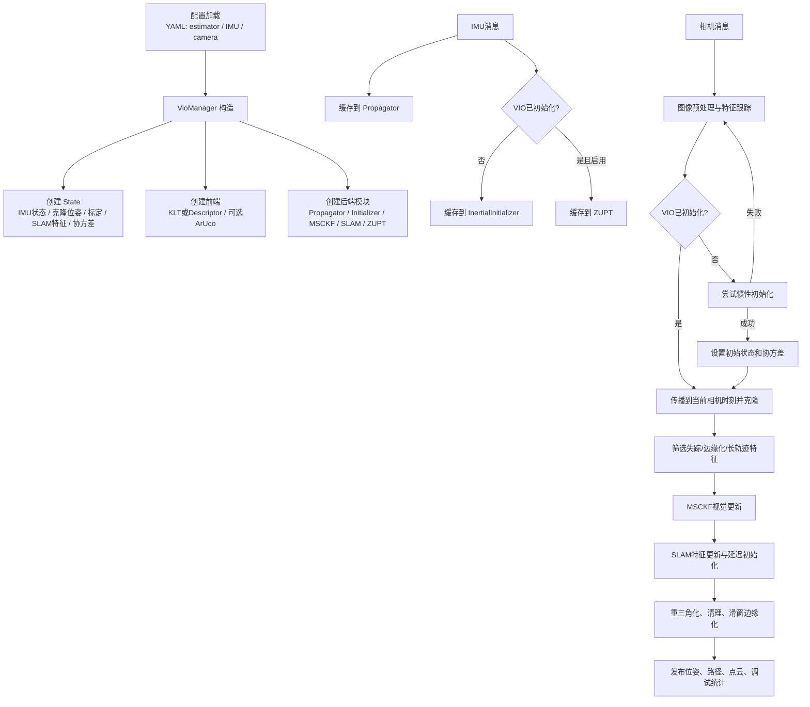
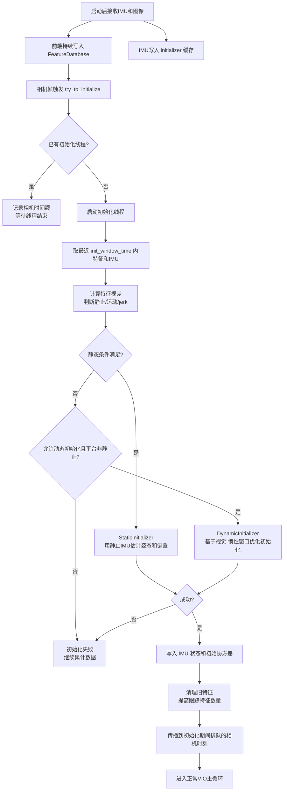
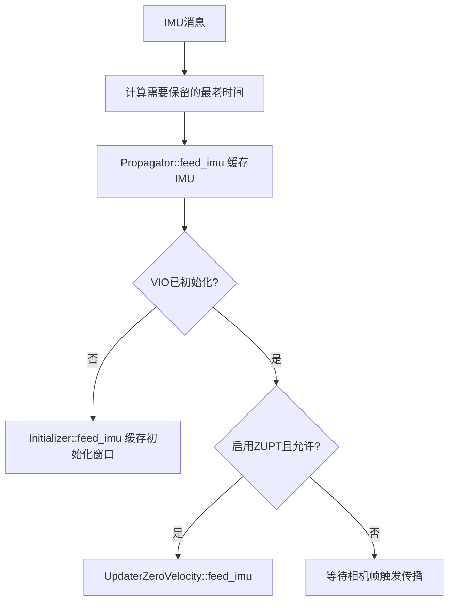
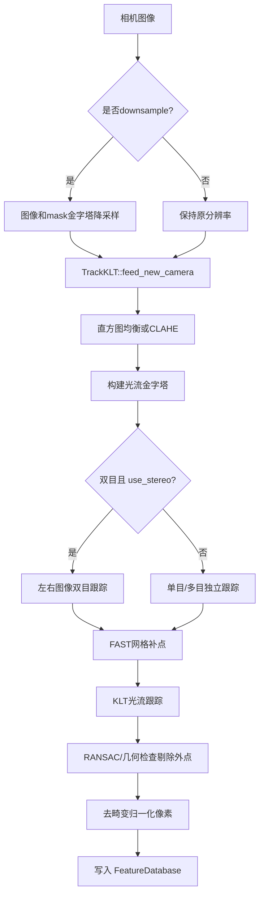
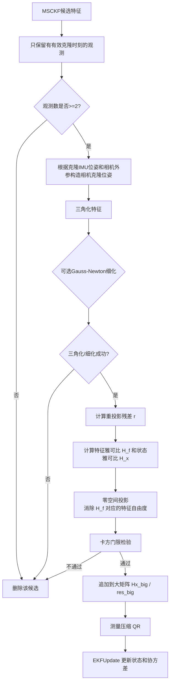
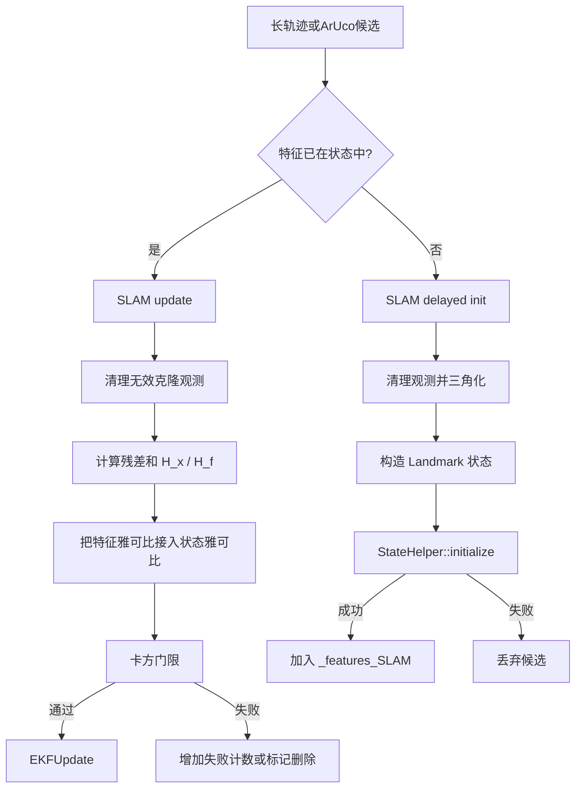
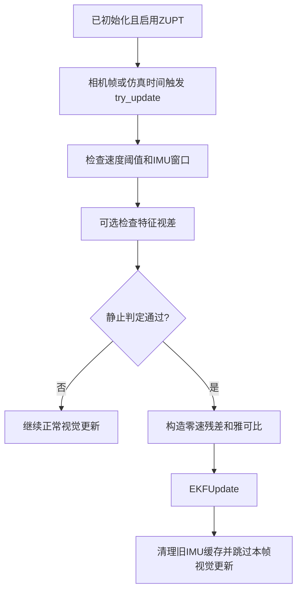

# OpenVINS 当前算法说明

本文档基于当前仓库代码整理 OpenVINS 的实际运行流程，重点对应 `ov_msckf` 主估计器、`ov_core` 特征前端和 `ov_init` 初始化模块。当前 EuRoC 配置文件为 `config/euroc_mav/estimator_config.yaml`，默认路径是双目 KLT 前端、IMU RK4 传播、EKF/MSCKF 滑窗更新，并在线估计相机外参、相机内参和相机-IMU 时间偏移。

## 1. 算法总览

OpenVINS 是滤波式视觉惯性里程计。系统以 IMU 为高频预测源，以相机图像触发低频更新；核心滤波器是误差状态 EKF，视觉更新采用 MSCKF 滑窗约束，并可选维护一部分长期 SLAM 特征和 ArUco 特征。



主要代码入口：

- ROS 入口：`ov_msckf/src/run_subscribe_msckf.cpp`
- ROS 回调与发布：`ov_msckf/src/ros/ROS1Visualizer.cpp`、`ov_msckf/src/ros/ROS2Visualizer.cpp`
- 主估计器：`ov_msckf/src/core/VioManager.cpp`
- IMU 传播：`ov_msckf/src/state/Propagator.cpp`
- EKF 状态与协方差管理：`ov_msckf/src/state/State.h`、`ov_msckf/src/state/StateHelper.cpp`
- MSCKF 更新：`ov_msckf/src/update/UpdaterMSCKF.cpp`
- SLAM/ArUco 更新：`ov_msckf/src/update/UpdaterSLAM.cpp`
- 初始化：`ov_init/src/init/InertialInitializer.cpp`
- KLT 前端：`ov_core/src/track/TrackKLT.cpp`

## 2. 输入与配置

当前 ROS 订阅链路将传感器消息转换成 OpenVINS 内部结构：

- IMU：`sensor_msgs/Imu` 转为 `ov_core::ImuData`，字段包括时间戳、角速度 $\boldsymbol{\omega}_m$（代码字段 `wm`）和线加速度 $\mathbf{a}_m$（代码字段 `am`）。
- 单目或多目图像：`sensor_msgs/Image` 转为 `ov_core::CameraData`，包含时间戳、相机 ID、灰度图和 mask。
- 双目配置下使用 `message_filters::Synchronizer` 同步左右图像，当前 EuRoC 配置订阅 `/cam0/image_raw`、`/cam1/image_raw`、`/imu0`。

当前 `config/euroc_mav/estimator_config.yaml` 的关键算法配置：

| 配置项 | 当前值 | 作用 |
| --- | --- | --- |
| `use_fej` | `true` | 使用 First-Estimate Jacobian，提高滤波一致性 |
| `integration` | `rk4` | IMU 均值使用 RK4 传播，协方差使用解析雅可比传播 |
| `use_stereo` | `true` | 双目特征跟踪 |
| `max_cameras` | `2` | 两个相机 |
| `calib_cam_extrinsics` | `true` | 在线估计 IMU 到相机外参 |
| `calib_cam_intrinsics` | `true` | 在线估计相机内参 |
| `calib_cam_timeoffset` | `true` | 在线估计相机到 IMU 时间偏移 |
| `calib_imu_intrinsics` | `false` | 当前不估计 IMU 内参 |
| `max_clones` | `11` | 滑窗中最多保留 11 个 IMU 克隆位姿 |
| `max_slam` | `50` | 状态中最多维护 50 个 SLAM 特征 |
| `max_msckf_in_update` | `40` | 每次最多使用 40 个 MSCKF 特征 |
| `use_klt` | `true` | 使用 KLT 光流前端 |
| `try_zupt` | `false` | 当前不启用零速更新 |
| `use_aruco` | `false` | 当前不启用 ArUco 跟踪 |

## 3. 状态向量

`State` 管理滤波器当前估计和协方差。用数学符号表示，核心状态可以概括为：

$$
\mathbf{x}=\begin{bmatrix}
\mathbf{x}_I &
\mathbf{x}_{c_1} & \cdots & \mathbf{x}_{c_N} &
\mathbf{f}_1 & \cdots & \mathbf{f}_M &
\Delta t_{CI} &
\mathbf{T}_{I}^{C_i} &
\boldsymbol{\zeta}_{C_i} &
\boldsymbol{\theta}_I
\end{bmatrix}^\top
$$

其中代码中的 `x_imu` 对应当前 IMU 状态 $\mathbf{x}_I$，`clone_imu(t_i)` 对应第 $i$ 个克隆位姿 $\mathbf{x}_{c_i}$，`x_slam_j` 对应第 $j$ 个 SLAM 特征 $\mathbf{f}_j$，`dt_cam_imu` 对应相机-IMU 时间偏移 $\Delta t_{CI}$，`T_imu_cam_i` 对应第 $i$ 个相机外参 $\mathbf{T}_{I}^{C_i}$，`cam_intrinsics_i` 对应相机内参 $\boldsymbol{\zeta}_{C_i}$，可选 `imu_intrinsics` 对应 IMU 内参 $\boldsymbol{\theta}_I$。

当前 IMU 状态可以进一步写成：

$$
\mathbf{x}_I=\begin{bmatrix}
\mathbf{q}_{G}^{I} &
\mathbf{p}_{I}^{G} &
\mathbf{v}_{I}^{G} &
\mathbf{b}_g &
\mathbf{b}_a
\end{bmatrix}^\top
$$

其中：

- 当前 IMU 状态 $\mathbf{x}_I$：姿态 $\mathbf{q}_{G}^{I}$、位置 $\mathbf{p}_{I}^{G}$、速度 $\mathbf{v}_{I}^{G}$、陀螺偏置 $\mathbf{b}_g$、加计偏置 $\mathbf{b}_a$。
- 克隆位姿 `_clones_IMU`：每个相机更新时刻克隆当前 IMU 位姿，数学上记为 $\mathbf{x}_{c_i}=\left[\mathbf{q}_{G}^{I_i},\mathbf{p}_{I_i}^{G}\right]$，只包含姿态和位置，用于构造 MSCKF 多状态约束。
- SLAM 特征 `_features_SLAM`：长期保留在状态向量中的特征点，数学上记为 $\mathbf{f}_j$，当前配置使用 `ANCHORED_MSCKF_INVERSE_DEPTH`。
- 标定状态：相机-IMU 时间偏移 $\Delta t_{CI}$、各相机外参 $\mathbf{T}_{I}^{C_i}$、各相机内参 $\boldsymbol{\zeta}_{C_i}$；当前 EuRoC 配置会在线估计这些量。
- 协方差 `_Cov`：数学上记为 $\mathbf{P}$，由 `StateHelper` 统一维护，传播、更新、克隆、边缘化都会同步调整变量顺序和协方差块。

## 4. 初始化流程

系统启动后并不会立即进入 MSCKF 更新，而是先积累一段 IMU 和特征轨迹，由 `InertialInitializer` 判断采用静态或动态初始化。



当前 EuRoC 配置 `init_dyn_use: false`，因此默认主要走静态初始化路径：

1. 收集 `init_window_time = 2.0s` 的 IMU 和特征观测。
2. 用图像特征视差判断平台是否静止或是否出现 jerk。
3. 静态初始化中，把最近窗口的加速度均值方向作为重力方向，估计初始姿态 $\mathbf{q}_{G}^{I}$；陀螺均值作为陀螺偏置 $\mathbf{b}_g$ 的初值；速度 $\mathbf{v}_{I}^{G}$ 和位置 $\mathbf{p}_{I}^{G}$ 按静止假设初始化。
4. 初始化成功后，`StateHelper::set_initial_covariance()` 将初始化模块返回的协方差写入滤波状态。

如果启用动态初始化，`DynamicInitializer` 会在初始化窗口内选择多个相机时刻和特征，结合 IMU 预积分/传播约束和视觉重投影约束估计初始姿态 $\mathbf{q}_{G}^{I}$、速度 $\mathbf{v}_{I}^{G}$、偏置 $\mathbf{b}_g,\mathbf{b}_a$ 和可选标定量。当前配置没有启用该路径。

## 5. IMU 处理与传播

IMU 消息到来时，`VioManager::feed_measurement_imu()` 执行缓存，不直接做完整后端更新：



相机帧触发 `Propagator::propagate_and_clone()` 时，系统从当前状态时间传播到相机时间：

1. 根据当前估计的相机-IMU 时间偏移换算 IMU 时间区间：$t_I = t_C + \Delta t_{CI}$，对应代码中的 `t_imu = t_cam + dt_cam_imu`。
2. 从缓存中选择并必要时插值 IMU 测量。
3. 对每个 IMU 间隔，先扣除当前偏置，再应用可选 IMU 内参模型。
4. 当前配置使用 RK4 积分更新姿态、速度、位置。
5. 计算误差状态转移矩阵 $\mathbf{F}$ 和离散噪声 $\mathbf{Q}_d$，累积得到总的状态转移矩阵 $\boldsymbol{\Phi}$ 与离散噪声协方差 $\mathbf{Q}_d$，对应代码中的 `Phi_summed` 与 `Qd_summed`。
6. 调用 `StateHelper::EKFPropagation()` 更新协方差。
7. 将当前 IMU 位姿克隆到滑窗中，供后续视觉约束使用。

传播形式可以概括为：

$$
\mathbf{x}_k^- = f\left(\mathbf{x}_{k-1}^+,\mathbf{u}_{I,k}\right)
$$

$$
\mathbf{P}_k^- = \boldsymbol{\Phi}_k\mathbf{P}_{k-1}^+\boldsymbol{\Phi}_k^\top + \mathbf{Q}_k
$$

其中 $\mathbf{x}_k^-$ 是传播后的先验状态，$\mathbf{x}_{k-1}^+$ 是上一时刻后验状态，$\mathbf{u}_{I,k}$ 是 IMU 输入，$\mathbf{P}_k^-$ 是先验协方差。

## 6. 图像前端

当前配置使用 `TrackKLT`。每个相机帧进入 `VioManager::track_image_and_update()` 后，先做特征前端处理：



前端维护 `FeatureDatabase`：

- 同一特征 ID 的跨时刻观测会追加到同一个 `Feature`。
- 每条观测包含原始像素坐标 $\mathbf{u}$（代码字段 `uv`）、归一化坐标 $\mathbf{u}_n$（代码字段 `uv_norm`）、相机 ID 和时间戳。
- 后端通过“已丢失特征”“包含最老克隆时刻的特征”“达到最大轨迹长度的特征”等查询接口取出可更新特征。

## 7. 每帧相机后端主循环

初始化完成后，每帧相机数据会进入 `VioManager::do_feature_propagate_update()`。

```mermaid
flowchart TD
  A[新相机帧] --> B{时间是否早于当前状态?}
  B -- 是 --> C[丢弃乱序帧]
  B -- 否 --> D[IMU传播到相机时刻]
  D --> E[克隆当前IMU位姿]
  E --> F{克隆数量是否足够?}
  F -- 否 --> G[等待至少 min(max_clones, 5) 个克隆]
  F -- 是 --> H[选取候选特征]
  H --> I[feats_lost: 当前帧丢失特征]
  H --> J[feats_marg: 包含最老克隆的特征]
  H --> K[feats_maxtracks: 达到最大轨迹长度的特征]
  K --> L{SLAM状态还有容量?}
  L -- 是 --> M[部分长轨迹转入SLAM延迟初始化候选]
  L -- 否 --> N[仍作为MSCKF候选]
  I --> O[组合MSCKF候选]
  J --> O
  N --> O
  M --> P[区分已有SLAM特征和新SLAM候选]
  O --> Q[按轨迹长度排序并限量]
  Q --> R[UpdaterMSCKF::update]
  P --> S[UpdaterSLAM::update 已有SLAM特征]
  S --> T[UpdaterSLAM::delayed_init 新SLAM特征]
  R --> U[重三角化活动轨迹用于可视化]
  T --> U
  U --> V[清理已使用特征]
  V --> W[SLAM锚点变更]
  W --> X[清理最老克隆之前观测]
  X --> Y[边缘化最老克隆]
  Y --> Z[输出状态和统计]
```

主循环的关键策略：

- 至少积累 5 个克隆位姿后才开始视觉更新，便于特征三角化。
- `feats_lost` 用于处理刚刚丢失跟踪的特征。
- `feats_marg` 用于处理即将随最老克隆一起被边缘化的观测。
- 达到最大轨迹长度的特征优先考虑转为 SLAM 特征；如果 SLAM 状态满了，则作为 MSCKF 特征使用。
- MSCKF 更新后会标记对应特征 `to_delete = true`，避免重复使用同一份信息。
- 若滑窗超过 `max_clones`，最后边缘化最老 IMU 克隆。

## 8. MSCKF 更新

MSCKF（Multi-State Constraint Kalman Filter，多状态约束卡尔曼滤波）的核心思想是：短期视觉特征点不进入滤波状态，而是先用它在多帧、多相机中的观测三角化出一个临时三维点，再把这个三维点对滑窗内多个相机位姿形成的几何约束写成 EKF 量测更新。由于特征点只是临时辅助变量，更新前会通过零空间投影消除特征自由度，最终只更新 IMU 当前状态、历史克隆位姿、相机标定和协方差。

当前实现入口是 `UpdaterMSCKF::update()`。它接收主循环筛选出的 MSCKF 候选特征，完成清理观测、构造相机克隆位姿、三角化、线性化、零空间投影、卡方门限、测量压缩和 EKF 更新。



### 8.1 输入与输出

MSCKF 更新的输入主要有两类：

- `state`：当前滤波器状态 $\mathbf{x}$，包含当前 IMU 状态 $\mathbf{x}_I$、滑窗 IMU 克隆位姿 $\mathbf{x}_{c_i}$、相机外参 $\mathbf{T}_{I}^{C_i}$、相机内参 $\boldsymbol{\zeta}_{C_i}$、时间偏移 $\Delta t_{CI}$、SLAM 特征 $\mathbf{f}_j$ 和完整协方差 $\mathbf{P}$（代码中为 `_Cov`）。
- `feature_vec`：本轮准备用于 MSCKF 更新的候选特征，通常来自刚丢失的特征、包含最老克隆时刻的特征，或者无法转为 SLAM 特征的长轨迹特征。

MSCKF 更新的输出不是新的特征地图，而是一次 EKF 修正：

- 修正当前状态 $\mathbf{x}$，例如姿态 $\mathbf{q}_{G}^{I}$、速度 $\mathbf{v}_{I}^{G}$、位置 $\mathbf{p}_{I}^{G}$、IMU bias $\mathbf{b}_g,\mathbf{b}_a$、相机标定等。
- 修正历史克隆位姿，使滑窗内的相机轨迹更符合视觉观测。
- 修正协方差 $\mathbf{P}$，降低被视觉约束观测到的状态不确定性。
- 把已经使用过的候选特征标记为 `to_delete = true`，避免后续重复使用同一份视觉信息。

### 8.2 候选特征清理

更新开始时，代码先从 `state->_clones_IMU` 取出滑窗中仍然有效的克隆时间戳。每个候选特征都会调用 `clean_old_measurements(clonetimes)` 删除不在滑窗内的旧观测。

清理后会统计该特征剩余观测数量。每个二维像素观测提供 2 维残差；但单个观测无法形成多视角几何约束，因此当前实现要求每个 MSCKF 特征至少有 2 次观测。如果观测数小于 2，该特征会被删除。

这里的“观测数”按相机和时间戳累计：双目同一时刻左右相机各看到一次特征，也会算作两次观测。是否足够三角化还取决于视差、深度正负和数值条件，后续三角化阶段还会继续筛掉失败特征。

### 8.3 构造相机克隆位姿

滤波状态中保存的是 IMU 克隆位姿 $\mathbf{x}_{c_i}$（代码中为 `_clones_IMU`），而视觉重投影需要相机位姿。代码会结合每个 IMU 克隆和相机外参 $\mathbf{T}_{I}^{C_i}$（代码中为 `_calib_IMUtoCAM`），为每个相机生成同一时刻的相机克隆位姿：

$$
\mathbf{R}_{G}^{C_i}=\mathbf{R}_{I}^{C_i}\mathbf{R}_{G}^{I}
$$

$$
\mathbf{p}_{C_i}^{G}=\mathbf{p}_{I}^{G}-\left(\mathbf{R}_{G}^{C_i}\right)^\top\mathbf{p}_{I}^{C_i}
$$

含义如下：

- $\mathbf{R}_{G}^{I}$：从全局坐标系 $G$ 旋转到 IMU 坐标系 $I$ 的旋转矩阵，对应代码中的 `R_GtoI`。
- $\mathbf{p}_{I}^{G}$：IMU 原点在全局坐标系中的位置，对应代码中的 `p_IinG`。
- $\mathbf{R}_{I}^{C_i}$：从 IMU 坐标系旋转到第 $i$ 个相机坐标系 $C_i$ 的外参旋转，对应代码中的 `R_ItoC`。
- $\mathbf{p}_{I}^{C_i}$：IMU 原点在第 $i$ 个相机坐标系中的位置，对应代码中的 `p_IinC`。
- $\mathbf{R}_{G}^{C_i}$：从全局坐标系旋转到第 $i$ 个相机坐标系的旋转矩阵，对应代码中的 `R_GtoC`。
- $\mathbf{p}_{C_i}^{G}$：第 $i$ 个相机原点在全局坐标系中的位置，对应代码中的 `p_CinG`。

这一步只是在当前估计值下计算临时相机位姿，方便后续三角化。真正进入 EKF 更新的状态变量仍然是 IMU 克隆位姿和标定变量。

### 8.4 特征三角化与细化

对每个通过清理的候选特征，`FeatureInitializer` 会根据该特征在多个相机克隆位姿下的观测恢复三维位置。当前配置 `feat_rep_msckf: "GLOBAL_3D"`，因此 MSCKF 临时特征默认使用全局三维点表示 $\mathbf{p}_{F}^{G}$，对应代码中的 `p_FinG`。

三角化可以理解为：已知多个相机位姿和多个像素射线，寻找一个三维点，使它投影到各相机后尽量接近实际观测。若配置启用一维三角化，则调用 `single_triangulation_1d()`；否则调用 `single_triangulation()`。若配置启用特征细化，则继续调用 `single_gaussnewton()` 用 Gauss-Newton 迭代最小化重投影误差。

三角化或细化失败的常见原因包括：

- 视差太小，多个观测射线几乎平行，深度不可稳定估计。
- 三角化出的点位于相机后方，深度不合理。
- 重投影误差过大，说明跟踪匹配可能错误。
- 数值条件差，优化无法得到可信的三维位置。

失败特征会被标记删除，不参与本次 EKF 更新。

### 8.5 重投影残差

对每个成功三角化的特征，代码调用 `UpdaterHelper::get_feature_jacobian_full()` 构造线性系统。核心量测模型是重投影模型：

$$
\mathbf{z}=h\left(\mathbf{x},\mathbf{p}_F\right)+\mathbf{n}
$$

$$
\mathbf{r}=\mathbf{z}-h\left(\mathbf{x},\mathbf{p}_F\right)
$$

其中：

- $\mathbf{z}$ 是前端给出的实际像素观测，当前实现使用畸变后的像素坐标。
- $h\left(\mathbf{x},\mathbf{p}_F\right)$ 是根据当前状态 $\mathbf{x}$ 和特征三维位置 $\mathbf{p}_F$ 预测出来的像素坐标。
- $\mathbf{n}$ 是像素量测噪声，当前 MSCKF 配置 `up_msckf_sigma_px: 1`，即每个像素方向的标准差为 1 像素。
- $\mathbf{r}$ 是重投影残差，表示“实际看到的位置”和“按当前状态预测的位置”之间的差。

单个观测的投影链路为：

$$
\mathbf{p}_{F}^{I}=\mathbf{R}_{G}^{I}\left(\mathbf{p}_{F}^{G}-\mathbf{p}_{I}^{G}\right)
$$

$$
\mathbf{p}_{F}^{C}=\mathbf{R}_{I}^{C}\mathbf{p}_{F}^{I}+\mathbf{p}_{I}^{C}
$$

$$
\mathbf{u}_{n}=\left[\frac{p_{F,x}^{C}}{p_{F,z}^{C}},\frac{p_{F,y}^{C}}{p_{F,z}^{C}}\right]^\top
$$

$$
\mathbf{u}_{d}=d\left(\mathbf{u}_{n},\boldsymbol{\zeta}_{C}\right)
$$

$$
\mathbf{r}=\mathbf{u}_{m}-\mathbf{u}_{d}
$$

这里 $\mathbf{p}_{F}^{I}$ 表示特征点在当前 IMU 坐标系下的位置，$\mathbf{p}_{F}^{C}$ 表示特征点在当前相机坐标系下的位置，$\mathbf{u}_{n}$ 是归一化像平面坐标，$\mathbf{u}_{d}$ 是考虑相机内参和畸变后的预测像素坐标，$\mathbf{u}_m$ 是实际像素观测。

### 8.6 线性化与雅可比

MSCKF 用一阶线性化把非线性重投影模型写成误差状态形式：

$$
\mathbf{r}=\mathbf{z}-h\left(\mathbf{x},\mathbf{p}_F\right)
$$

$$
\mathbf{r}\approx\mathbf{H}_x\delta\mathbf{x}+\mathbf{H}_f\delta\mathbf{p}_F+\mathbf{n}
$$

各符号含义如下：

- $\mathbf{x}$：滤波器当前名义状态。
- $\delta\mathbf{x}$：误差状态增量，即 EKF 实际求解的小量修正，对应代码中的 `dx`。
- $\mathbf{p}_F$：临时特征三维位置。
- $\delta\mathbf{p}_F$：特征位置误差增量，对应代码中的 `dp_f`。
- $\mathbf{H}_x$：残差对状态误差 $\delta\mathbf{x}$ 的雅可比矩阵，对应代码中的 `H_x`。
- $\mathbf{H}_f$：残差对特征误差 $\delta\mathbf{p}_F$ 的雅可比矩阵，对应代码中的 `H_f`。
- $\mathbf{n}$：量测噪声。

$\mathbf{H}_x$ 中包含哪些状态块由该特征的观测历史决定。当前实现会把以下变量加入该特征的局部状态顺序 `Hx_order`：

- 看到该特征的 IMU 克隆位姿。
- 如果在线估计相机外参，则包含对应相机的外参状态。
- 如果在线估计相机内参，则包含对应相机的内参状态。
- 如果特征使用 anchored 表示，还包含锚定时刻的克隆位姿和可能的锚定相机外参。

当前 EuRoC 配置使用 `use_fej: true`。FEJ（First-Estimate Jacobian，初始估计雅可比）表示：残差值仍按当前最优估计计算，但部分雅可比在第一次估计值处线性化。这能减少滤波器反复在线性化点变化时引入的虚假信息，有助于保持 VIO 的一致性。

### 8.7 零空间投影：消除特征自由度

如果直接把上式送入 EKF，状态里就需要包含 $\mathbf{p}_F$。但 MSCKF 的设计目标是让短期特征不进入状态，因此需要消掉 $\delta\mathbf{p}_F$。做法是寻找 $\mathbf{H}_f$ 的左零空间矩阵 $\mathbf{N}$，满足：

$$
\mathbf{N}^\top\mathbf{H}_f=\mathbf{0}
$$

将线性系统左乘 $\mathbf{N}^\top$：

$$
\mathbf{N}^\top\mathbf{r}\approx\mathbf{N}^\top\mathbf{H}_x\delta\mathbf{x}+\mathbf{N}^\top\mathbf{n}
$$

由于 $\mathbf{N}^\top\mathbf{H}_f\delta\mathbf{p}_F=\mathbf{0}$，特征误差项被消除，剩下的约束只与滤波状态误差 $\delta\mathbf{x}$ 有关。这样既利用了该特征跨多帧观测提供的几何约束，又不需要把短期特征长期保存在状态向量中。

实现上，`UpdaterHelper::nullspace_project_inplace()` 没有显式构造完整的 $\mathbf{N}$，而是用 Givens rotation 对 $\mathbf{H}_f$ 做类似 QR 分解的行变换，并把同样的行变换同步作用到 $\mathbf{H}_x$ 和残差 $\mathbf{r}$。最后丢弃与 $\mathbf{H}_f$ 列空间对应的前几行，只保留左零空间中的有效约束。

约束维度可以这样理解：

- 每个二维观测提供 2 行残差。
- 若特征是普通三维点，$\delta\mathbf{p}_F$ 有 3 个自由度。
- 零空间投影后，该特征最多保留 `2 * 观测数 - 3` 行约束。
- 如果剩余约束太少或数值退化，后续门限检验通常会把它排除。

### 8.8 卡方门限检验

零空间投影后，每个特征都会做一次卡方检验，用于拒绝外点或不一致的观测：

$$
\mathbf{S}=\mathbf{H}_x\mathbf{P}_{m}\mathbf{H}_x^\top+\sigma_{pix}^2\mathbf{I}
$$

$$
\chi^2=\mathbf{r}^\top\mathbf{S}^{-1}\mathbf{r}
$$

其中：

- $\mathbf{P}_{m}$ 是只取出该特征相关状态块后的边缘协方差，对应代码中的 `P_marg`。
- $\mathbf{S}$ 是残差协方差，描述在当前状态不确定性和像素噪声共同作用下，残差应该有多大。
- $\sigma_{pix}^2\mathbf{I}$ 是像素量测噪声协方差，当前配置为 $1^2\mathbf{I}$。
- $\chi^2$ 是归一化残差平方，也称 Mahalanobis distance，对应代码中的 `chi2`。

代码预先构造 95% 置信度的卡方分布表 `chi_squared_table`。如果：

$$
\chi^2 > \lambda_{\chi^2} \, \chi^2_{th}
$$

其中 $\lambda_{\chi^2}$ 对应配置 `up_msckf_chi2_multipler`，$\chi^2_{th}$ 是当前残差维度下 95% 置信度的卡方门限。

该特征会被拒绝。当前 EuRoC 配置 `up_msckf_chi2_multipler: 1`，即使用 95% 卡方门限本身。这个检验的直观含义是：如果一个特征的残差相对于当前不确定性大得不合理，它更可能是错误匹配、动态物体、三角化失败或模型误差，不应参与滤波更新。

### 8.9 组装大线性系统

所有通过卡方门限的特征会被追加到同一个大残差向量和大雅可比矩阵：

$$
\mathbf{r}_{big}=\begin{bmatrix}
\mathbf{r}_1\\
\mathbf{r}_2\\
\vdots\\
\mathbf{r}_k
\end{bmatrix}
$$

$$
\mathbf{H}_{x,big}=\begin{bmatrix}
\mathbf{H}_{x,1}\\
\mathbf{H}_{x,2}\\
\vdots\\
\mathbf{H}_{x,k}
\end{bmatrix}
$$

由于不同特征可能涉及不同的克隆位姿和标定变量，代码用 `Hx_mapping` 和 `Hx_order_big` 记录每个状态块在 $\mathbf{H}_{x,big}$ 中的列偏移。这样 `StateHelper::EKFUpdate()` 可以根据 `Hx_order_big` 从完整协方差 `_Cov` 中取出正确的协方差块，而不要求 `Hx_big` 覆盖整个状态向量。

组装完成后，所有仍留在 `feature_vec` 中的特征都会被标记为 `to_delete = true`。原因是这些视觉观测的信息已经进入滤波器，重复使用会造成信息双计，使协方差过度自信。

### 8.10 测量压缩

如果通过门限的特征很多，$\mathbf{H}_{x,big}$ 的行数可能远大于列数。直接 EKF 更新会在残差协方差 $\mathbf{S}$ 上做大矩阵求解，计算量较高。OpenVINS 调用 `UpdaterHelper::measurement_compress_inplace()` 做测量压缩。

测量压缩的目标是保留对状态有信息的行空间，删除线性相关或多余的残差行。实现方式仍然是 Givens rotation：对 $\mathbf{H}_{x,big}$ 做上三角化，并对 $\mathbf{r}_{big}$ 施加相同变换，然后只保留前 `min(Hx_big.rows(), Hx_big.cols())` 行。

压缩不会改变这批量测对状态的线性约束含义，但可以显著降低后续 EKF 更新的矩阵规模。

### 8.11 EKF 更新

压缩后构造量测噪声矩阵：

$$
\mathbf{R}_{big}=\sigma_{pix}^2\mathbf{I}
$$

然后调用 `StateHelper::EKFUpdate(state, Hx_order_big, Hx_big, res_big, R_big)`。EKF 更新形式为：

$$
\mathbf{S}=\mathbf{H}\mathbf{P}\mathbf{H}^\top+\mathbf{R}
$$

$$
\mathbf{K}=\mathbf{P}\mathbf{H}^\top\mathbf{S}^{-1}
$$

$$
\delta\mathbf{x}=\mathbf{K}\mathbf{r}
$$

$$
\mathbf{P}\leftarrow\mathbf{P}-\mathbf{K}\left(\mathbf{P}\mathbf{H}^\top\right)^\top
$$

$$
\mathbf{x}\leftarrow\mathbf{x}\boxplus\delta\mathbf{x}
$$

在代码中，$\mathbf{P}$ 是完整状态协方差 `_Cov`，但 $\mathbf{H}$ 只包含 `Hx_order_big` 中涉及的变量。`StateHelper::EKFUpdate()` 会先计算每个状态变量对应的 $\mathbf{P}\mathbf{H}^\top$，再求 Kalman 增益 $\mathbf{K}$，最后更新完整协方差和所有活动状态变量。

$\boxplus$ 表示流形上的状态加法。普通向量状态可以直接相加；姿态这类旋转状态不能简单逐元素相加，需要把小角度误差转换成旋转增量后再复合到当前姿态上。

### 8.12 关键术语说明

| 术语 | 解释 |
| --- | --- |
| MSCKF | Multi-State Constraint Kalman Filter，多状态约束卡尔曼滤波。用同一个特征在多个历史相机位姿中的观测约束这些位姿，但不把短期特征加入状态。 |
| EKF | Extended Kalman Filter，扩展卡尔曼滤波。用非线性模型预测和更新状态，并通过一阶线性化传播协方差。 |
| 误差状态 | EKF 实际求解的小量误差 $\delta\mathbf{x}$，用于修正名义状态 $\mathbf{x}$。VIO 常用误差状态处理姿态 $\mathbf{q}_{G}^{I}$、偏置 $\mathbf{b}_g,\mathbf{b}_a$ 和标定等变量。 |
| 名义状态 | 当前保存的状态估计值，例如姿态、速度、位置、bias、相机外参等。 |
| 协方差 $\mathbf{P}$ | 状态不确定性的矩阵表示。对角块表示单个变量的不确定性，非对角块表示变量之间的相关性；代码中主要对应 `_Cov`。 |
| 滑窗 | 只保留最近一段历史状态的窗口。OpenVINS 中主要是有限数量的 IMU 克隆位姿。 |
| 克隆位姿 | 图像时刻复制出来的历史 IMU 位姿，只包含姿态和位置，用于让视觉特征同时约束多个历史时刻。 |
| IMU 克隆 | 保存在 `_clones_IMU` 中的历史 IMU pose，是 MSCKF 多状态约束的主要状态块。 |
| 相机克隆位姿 | 由 IMU 克隆位姿和相机外参临时计算出的相机 pose，用于三角化和重投影。 |
| 特征 | 图像中被跟踪的角点或纹理点。MSCKF 特征是短期使用的点，SLAM 特征则会进入状态长期维护。 |
| 候选特征 | 主循环筛选出来、准备尝试用于 MSCKF 更新的特征。它可能最终因观测不足、三角化失败或卡方检验失败而被丢弃。 |
| 观测 | 某个特征在某个相机、某个时间戳下的二维像素位置。 |
| 双目观测 | 同一时刻左右相机分别看到同一特征形成的观测，可以提供更强的深度约束。 |
| 三角化 | 根据多个相机位姿和多个二维观测恢复三维特征位置的过程。 |
| Gauss-Newton | 一种非线性最小二乘迭代方法，用于细化三角化结果并减小重投影误差。 |
| 重投影 | 把估计出的三维点通过当前相机模型投影回图像平面。 |
| 重投影误差/残差 $\mathbf{r}$ | 实际像素观测 $\mathbf{z}$ 与预测像素 $h(\mathbf{x},\mathbf{p}_F)$ 的差。 |
| 归一化像平面坐标 | 透视除法后的坐标 `[x / z, y / z]`，尚未加入具体相机内参和畸变。 |
| 畸变 | 镜头导致的像素位置偏移。OpenVINS 根据相机模型把归一化坐标转换为畸变后的像素预测。 |
| 相机内参 | 焦距、主点、畸变参数等描述相机成像模型的参数。当前配置允许在线估计。 |
| 相机外参 | IMU 坐标系与相机坐标系之间的旋转和平移。当前配置允许在线估计。 |
| 时间偏移 | 相机时间戳与 IMU 时间基准之间的偏差。当前配置允许在线估计，但 MSCKF 线性化细节由更上层的时间处理和状态定义配合完成。 |
| 雅可比 $\mathbf{H}_x$ | 残差对状态误差 $\delta\mathbf{x}$ 的偏导数，描述状态小变化会如何改变预测像素。 |
| 雅可比 $\mathbf{H}_f$ | 残差对特征位置误差 $\delta\mathbf{p}_F$ 的偏导数，描述三维点小变化会如何改变预测像素。 |
| 线性化 | 在当前估计附近用一阶泰勒展开近似非线性模型。 |
| FEJ | First-Estimate Jacobian。使用初始估计点计算部分雅可比，提高滤波一致性。 |
| 零空间 | 对矩阵 $\mathbf{H}_f$ 左乘后结果为 $\mathbf{0}$ 的向量空间。MSCKF 用它消除特征位置误差项。 |
| 左零空间矩阵 $\mathbf{N}$ | 满足 $\mathbf{N}^\top\mathbf{H}_f=\mathbf{0}$ 的矩阵。它把残差投影到不受特征误差影响的子空间。 |
| Givens rotation | 一种通过二维旋转消去矩阵元素的数值线性代数方法。这里用于零空间投影和测量压缩。 |
| QR 分解 | 把矩阵分解为正交矩阵和上三角矩阵的过程。OpenVINS 用 Givens rotation 实现了等价的行变换思想。 |
| 卡方检验 | 用卡方分布判断残差是否符合当前不确定性假设的统计检验。 |
| Mahalanobis distance | 归一化残差平方 $\mathbf{r}^\top\mathbf{S}^{-1}\mathbf{r}$，残差会按自身协方差 $\mathbf{S}$ 进行尺度归一。 |
| 量测噪声 $\mathbf{R}$ | 观测噪声协方差。MSCKF 中通常用像素噪声方差 $\sigma_{pix}^2$ 乘单位阵 $\mathbf{I}$。 |
| 像素噪声 $\sigma_{pix}$ | 单个像素方向的标准差。当前 EuRoC MSCKF 更新使用 `up_msckf_sigma_px: 1`。 |
| 测量压缩 | 在不改变线性约束信息的前提下减少残差行数，降低 EKF 更新计算量。 |
| `Hx_order` | 单个特征局部雅可比中状态块的顺序列表。 |
| `Hx_order_big` | 所有通过门限的特征合并后，大雅可比矩阵中的状态块顺序列表。 |
| `Hx_mapping` | 从状态变量指针到大雅可比列偏移的映射，用于把不同特征的局部雅可比放入统一矩阵。 |
| $\mathbf{r}_{big}$ | 所有通过门限的特征残差堆叠后的大残差向量，对应代码中的 `res_big`。 |
| $\mathbf{H}_{x,big}$ | 所有通过门限的特征状态雅可比堆叠后的大雅可比矩阵，对应代码中的 `Hx_big`。 |
| `to_delete` | 特征数据库中的删除标记。MSCKF 使用过或判定无效的特征会被标记，后续清理阶段删除。 |
| 信息双计 | 同一份观测被重复用于滤波更新，导致滤波器错误地认为不确定性更小。MSCKF 更新后删除特征就是为了避免这个问题。 |
| $\boxplus$ | 状态流形上的加法操作。对姿态等非欧式变量使用小扰动复合，而不是普通加法。 |

### 8.13 与 SLAM 特征更新的区别

MSCKF 特征和 SLAM 特征都会产生视觉重投影约束，但状态处理方式不同：

- MSCKF 特征不进入状态，三角化后只作为临时变量使用，随后通过零空间投影消掉。
- SLAM 特征进入状态，后续观测会直接更新该特征本身以及相关位姿、标定变量。
- MSCKF 更新适合大量短期特征，状态规模稳定，实时性好。
- SLAM 更新适合少量长期稳定特征，有利于跨更长时间维持约束，但会增加状态维度。

因此当前主循环会优先把部分长轨迹特征转为 SLAM 特征；剩余短期轨迹或无法进入 SLAM 状态的特征则走 MSCKF 更新。

## 9. SLAM 特征更新与延迟初始化

SLAM 特征与 MSCKF 特征不同：它们会被加入状态向量，后续观测直接更新特征本身和相关状态。当前配置最多维护 50 个 SLAM 特征，且延迟 `dt_slam_delay = 1s` 后才开始初始化，降低初始阶段不稳定轨迹的影响。



SLAM 更新与 MSCKF 更新的主要差异：

- MSCKF 特征不在状态中，需零空间投影消除特征自由度。
- SLAM 特征 $\mathbf{f}_j$ 已经在状态中，特征雅可比 $\mathbf{H}_f$ 会作为状态雅可比的一部分进入 EKF 更新。
- 对 `ANCHORED_INVERSE_DEPTH_SINGLE` 这类单深度表示，会只保留逆深度 $\rho$ 自由度，并对 bearing 部分做投影，以避免把已边缘化的 bearing 当作确定量。
- 如果 SLAM 特征持续更新失败或在其关联相机中丢失，会被标记并边缘化；ArUco 特征有特殊保护逻辑，不按普通 SLAM 点直接删除。

## 10. 零速更新路径

当前 EuRoC 配置 `try_zupt: false`，默认不启用零速更新。若启用，`UpdaterZeroVelocity` 会在已初始化后尝试检测平台静止：

- IMU 检测：使用短时间窗口内的 IMU 运动一致性和卡方门限。
- 视觉检测：使用特征平均视差，若视差低于 `zupt_max_disparity` 且特征数足够，则认为可能静止。
- 通过检测后，把速度约束 $\mathbf{v}_{I}^{G}\approx\mathbf{0}$ 和可选的零角速度/零加速度约束作为 EKF 更新写入状态。
- 若只允许初始化初期使用 ZUPT，一旦系统移动过，后续不再尝试零速更新。



## 11. 边缘化与数据清理

OpenVINS 使用滑窗控制状态规模。每帧更新末尾会执行：

1. `trackFEATS->get_feature_database()->cleanup()`：删除已用于更新并标记 `to_delete` 的特征。
2. `updaterSLAM->change_anchors()`：如果某个 SLAM 特征锚定在即将边缘化的克隆上，则先切换锚点，保证特征表示仍有效。
3. `cleanup_measurements(state->margtimestep())`：清理早于最老克隆时间的观测。
4. `StateHelper::marginalize_old_clone()`：当克隆数量超过 `max_clones` 时，从状态向量和协方差中删除最老克隆。
5. `StateHelper::marginalize_slam()`：删除已标记边缘化的普通 SLAM 特征。

边缘化实现不是重新构建优化问题，而是直接从 EKF 状态向量和协方差矩阵中删除对应变量块，并更新后续变量的局部索引。这与滤波式滑窗设计一致，保证实时性。

## 12. 输出

ROS 可视化层会发布：

- `poseimu`：当前 IMU 位姿及协方差。
- `odomimu`：当前 IMU 里程计，IMU 高频回调中也可用缓存传播结果发布。
- `pathimu`：历史轨迹。
- `points_msckf`：最近 MSCKF 更新使用的三角化点。
- `points_slam`：状态中维护的 SLAM 点。
- `points_aruco`：ArUco 点，当前配置默认不启用。
- `trackhist`：特征跟踪可视化图。
- 可选真值、TF、回环辅助信息和完整状态文件。

## 13. 当前算法一句话总结

当前配置下，OpenVINS 对 EuRoC 双目数据的实际流程是：先用 2 秒左右 IMU 和双目特征轨迹完成静态惯性初始化；之后每个同步双目帧先用缓存 IMU RK4 传播并克隆当前位姿，再用 KLT 特征轨迹构造 MSCKF 多状态视觉约束，同时维护少量长期 SLAM 特征；所有约束通过误差状态 EKF 更新当前 IMU 状态、滑窗克隆、相机标定和协方差，最后清理已用特征并边缘化最老克隆以保持实时滑窗规模。
